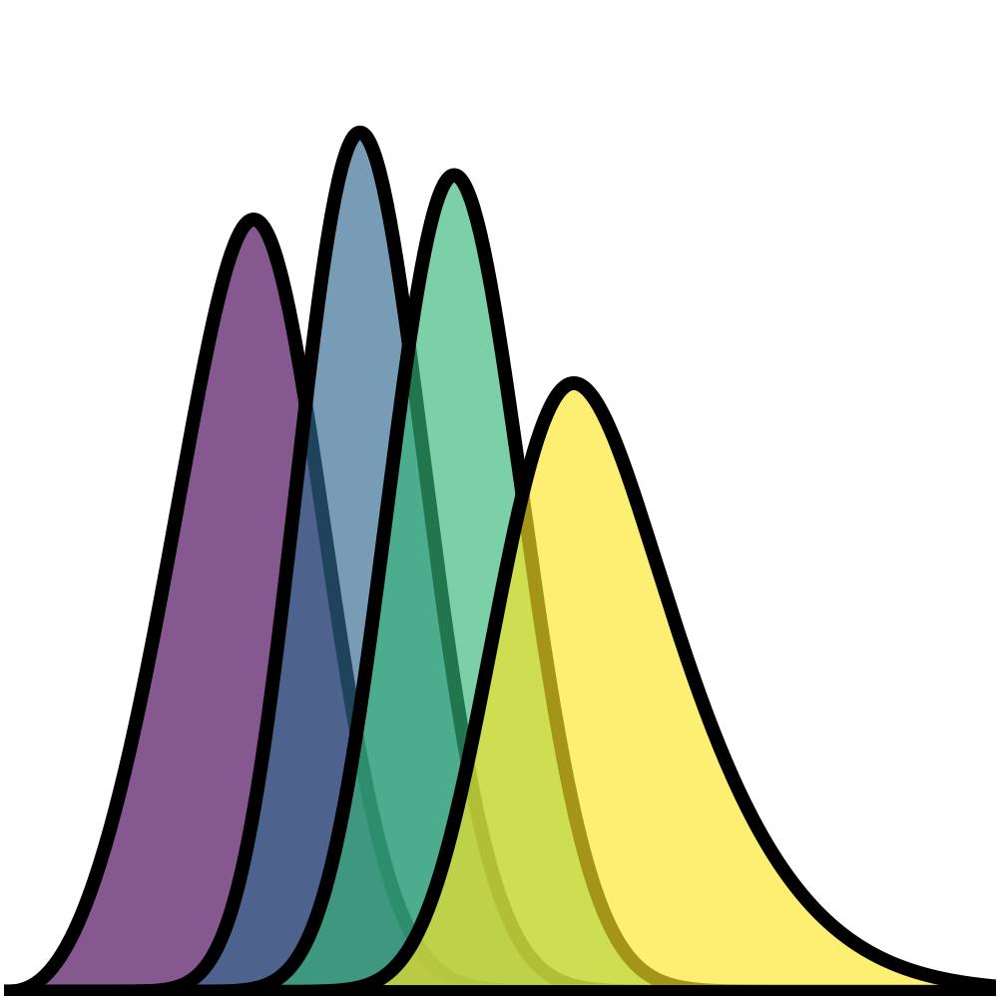

|logo| Parent distribution statistics
=====================================

Before constructing tomographic bins, it is useful to characterize the
underlying parent redshift distribution, :math:`n(z)`.

The parent distribution describes the redshift dependence of the full
galaxy sample before it is divided into tomographic bins.
Its statistical properties determine the characteristic redshift range,
width, asymmetry, and possible multimodality of the sample.

Binny provides parent distribution statistics through
:class:`binny.NZTomography`, including:

- **moments**, such as the mean, median, mode, standard deviation,
  skewness, and kurtosis,
- **quantiles**, which characterize the cumulative distribution and
  its central redshift intervals,
- **peak diagnostics**, which identify the dominant peak and possible
  secondary structure.

These statistics are computed directly from the parent :math:`n(z)`,
independently of the tomographic bins.

The examples below demonstrate how to calculate and visualize these
quantities using a representative parent redshift distribution.

All plotting examples below are executable via ``.. plot::``.
The plotting code is hidden by default and can be inspected using
the ``Source code`` button.

Building a parent redshift distribution
---------------------------------------

We begin with a smooth parent redshift distribution using the Smail
parameterization.

This model provides a simple representation of the redshift dependence
of a galaxy sample and is commonly used in cosmological forecasts.

For this example, we construct the parent distribution and pass it
to Binny using predefined tomography.

The predefined bins are used only to initialize the tomography object.
The parent statistics are evaluated directly from the supplied
distribution rather than reconstructed from those bins.

.. code-block:: python

   import numpy as np

   from binny import NZTomography

   z = np.linspace(0.0, 2.0, 1000)

   nz = NZTomography.nz_model(
       "smail",
       z,
       z0=0.2,
       alpha=2.0,
       beta=1.0,
       normalize=True,
   )

   tomography = NZTomography()

   result = tomography.build_predefined_bins(
       z=z,
       nz=nz,
       bins={0: nz},
   )

   stats = tomography.parent_stats(decimal_places=4)

   print(stats)

Accessing parent statistics
---------------------------

The :meth:`binny.NZTomography.parent_stats` method returns a dictionary
containing three groups of statistics:

- ``moments``: central tendency, dispersion, and higher-order moments,
- ``quantiles``: redshift values corresponding to requested cumulative
  probabilities,
- ``peaks``: information about the dominant peak and secondary maxima.

For example, the mean, median, mode, and standard deviation can be
accessed directly from the returned dictionary.

.. code-block:: python

   stats = tomography.parent_stats(decimal_places=4)

   moments = stats["moments"]

   print("Mean:", moments["mean"])
   print("Median:", moments["median"])
   print("Mode:", moments["mode"])
   print("Standard deviation:", moments["std"])
   print("Skewness:", moments["skewness"])
   print("Excess kurtosis:", moments["kurtosis"])

   print("Quantiles:", stats["quantiles"])
   print("Peaks:", stats["peaks"])

The same statistics are also available through the returned
:class:`binny.nz_tomo._tomography_bins.TomographyBins` object.

.. code-block:: python

   stats = result.parent_stats(decimal_places=4)

Both interfaces operate on the same stored parent distribution and
therefore return identical statistics when called with the same
arguments.

Visualizing the mean, median, and mode
--------------------------------------

The **mean**, **median**, and **mode** provide three complementary
descriptions of the characteristic redshift of a galaxy sample.

The mean is the expectation value of redshift under the normalized
parent distribution.
The median divides the integrated distribution into two equal parts,
while the mode identifies the redshift at which the distribution
reaches its maximum.

For a symmetric, unimodal distribution, these quantities generally
coincide.
For asymmetric distributions, they can differ substantially.

This distinction is useful in cosmological analyses because a single
representative redshift does not necessarily capture the full shape
of the underlying galaxy population.

.. plot::
   :include-source: False
   :width: 760

   import cmasher as cmr
   import matplotlib.pyplot as plt
   import numpy as np

   from binny import NZTomography

   z = np.linspace(0.0, 2.0, 1000)

   nz = NZTomography.nz_model(
       "smail",
       z,
       z0=0.2,
       alpha=2.0,
       beta=1.0,
       normalize=True,
   )

   result = NZTomography().build_predefined_bins(
       z=z,
       nz=nz,
       bins={0: nz},
   )

   moments = result.parent_stats(decimal_places=None)["moments"]

   colors = cmr.take_cmap_colors(
       "viridis",
       3,
       cmap_range=(0.0, 1.0),
       return_fmt="hex",
   )

   colors = dict(zip(("mean", "median", "mode"), colors, strict=True))

   fig, ax = plt.subplots(figsize=(8.0, 4.8))

   ax.plot(
       z,
       nz,
       color="k",
       linewidth=2.5,
       label=r"Parent $n(z)$",
   )

   for key in ("mean", "median", "mode"):
       ax.axvline(
           moments[key],
           color=colors[key],
           linestyle="-",
           linewidth=2.0,
           label=f"{key.capitalize()} = {moments[key]:.3f}",
       )

   ax.set_xlabel("Redshift $z$")
   ax.set_ylabel(r"Normalized $n(z)$")
   ax.set_title("Representative parent redshifts")
   ax.legend(frameon=False)

   plt.tight_layout()

Quantiles and central redshift intervals
----------------------------------------

Quantiles describe how the integrated probability of the parent
distribution is distributed across redshift.

For example, the 16th, 50th, and 84th percentiles provide a convenient
summary of the central part of the distribution.

The interval between the 16th and 84th percentiles contains
approximately 68% of the integrated distribution.

Unlike the standard deviation, quantile-based intervals do not require
the distribution to be Gaussian.
They therefore remain useful when the parent distribution is asymmetric
or contains extended tails.

Binny allows arbitrary quantiles to be requested using the
``quantiles`` argument.

.. code-block:: python

   stats = tomography.parent_stats(
       quantiles=(0.05, 0.16, 0.50, 0.84, 0.95),
       decimal_places=4,
   )

   print(stats["quantiles"])
   print(stats["moments"]["width_68"])

The following figure illustrates the central 68% interval of the
parent distribution.

.. plot::
   :include-source: False
   :width: 760

   import cmasher as cmr
   import matplotlib.pyplot as plt
   import numpy as np
   from matplotlib.colors import to_rgba

   from binny import NZTomography

   z = np.linspace(0.0, 2.0, 1000)

   nz = NZTomography.nz_model(
       "smail",
       z,
       z0=0.2,
       alpha=2.0,
       beta=1.0,
       normalize=True,
   )

   result = NZTomography().build_predefined_bins(
       z=z,
       nz=nz,
       bins={0: nz},
   )

   stats = result.parent_stats(decimal_places=None)

   q16 = stats["quantiles"][0.16]
   q50 = stats["quantiles"][0.50]
   q84 = stats["quantiles"][0.84]

   colors = cmr.take_cmap_colors(
       "viridis",
       3,
       cmap_range=(0.0, 1.0),
       return_fmt="hex",
   )

   _, interval_color, median_color = colors

   fig, ax = plt.subplots(figsize=(8.0, 4.8))

   ax.plot(
       z,
       nz,
       color="k",
       linewidth=2.5,
       label=r"Parent $n(z)$",
   )

   ax.fill_between(
       z,
       0.0,
       nz,
       where=(z >= q16) & (z <= q84),
       color=to_rgba(interval_color, 0.6),
       linewidth=0.0,
       label="Central 68% interval",
   )

   ax.axvline(
       q16,
       color=interval_color,
       linestyle="-",
       linewidth=2.0,
   )

   ax.axvline(
       q84,
       color=interval_color,
       linestyle="-",
       linewidth=2.0,
   )

   ax.axvline(
       q50,
       color=median_color,
       linestyle="-",
       linewidth=2.0,
       label="Median",
   )

   ax.plot(
       z,
       np.zeros_like(z),
       color="k",
       linewidth=2.2,
   )

   ax.set_xlabel("Redshift $z$")
   ax.set_ylabel(r"Normalized $n(z)$")
   ax.set_title("Parent redshift quantiles")
   ax.legend(frameon=False)

   plt.tight_layout()

Identifying multiple peaks
--------------------------

A parent redshift distribution does not necessarily contain a single
dominant population.

Multiple peaks can arise when combining galaxy samples with different
selection functions or redshift distributions.

Such structure can affect the interpretation of representative
redshifts and may influence the properties of subsequently constructed
tomographic bins.

Binny provides peak diagnostics through the ``peaks`` entry of
``parent_stats()``.

The returned quantities include:

- ``mode``: redshift of the global maximum,
- ``mode_height``: height of the distribution at the global maximum,
- ``num_peaks``: number of significant local maxima,
- ``second_peak_ratio``: relative height of the second-highest peak
  compared with the highest detected peak.

The ``min_rel_height`` argument controls the minimum peak height
relative to the global maximum.

The following example uses a synthetic bimodal parent distribution.

.. plot::
   :include-source: False
   :width: 760

   import cmasher as cmr
   import matplotlib.pyplot as plt
   import numpy as np
   from matplotlib.colors import to_rgba

   from binny import NZTomography

   z = np.linspace(0.0, 2.0, 1500)

   nz = (
       np.exp(-0.5 * ((z - 0.6) / 0.12) ** 2)
       + 0.55 * np.exp(-0.5 * ((z - 1.4) / 0.15) ** 2)
   )

   nz /= np.trapezoid(nz, x=z)

   result = NZTomography().build_predefined_bins(
       z=z,
       nz=nz,
       bins={0: nz},
   )

   peaks = result.parent_stats(
       min_rel_height=0.1,
       decimal_places=None,
   )["peaks"]

   colors = cmr.take_cmap_colors(
       "viridis",
       3,
       cmap_range=(0.0, 1.0),
       return_fmt="hex",
   )

   mode_color, _, peak_color = colors

   fig, ax = plt.subplots(figsize=(8.0, 4.8))

   ax.fill_between(
       z,
       0.0,
       nz,
       color=to_rgba(peak_color, 0.6),
       linewidth=0.0,
   )

   ax.plot(
       z,
       nz,
       color="k",
       linewidth=2.5,
       label=r"Parent $n(z)$",
   )

   ax.axvline(
       peaks["mode"],
       color=mode_color,
       linestyle="-",
       linewidth=2.0,
       label="Global mode",
   )

   ax.plot(
       z,
       np.zeros_like(z),
       color="k",
       linewidth=2.2,
   )

   ax.set_xlabel("Redshift $z$")
   ax.set_ylabel(r"Normalized $n(z)$")
   ax.set_title(
       f"Parent distribution with {int(peaks['num_peaks'])} significant peaks"
   )
   ax.legend(frameon=False)

   plt.tight_layout()

The number of detected peaks depends on the chosen relative-height
threshold and the resolution of the redshift grid.

Peak diagnostics should therefore be interpreted as descriptive
summaries rather than definitive evidence for physically distinct
galaxy populations.

Parent statistics and tomographic binning
-----------------------------------------

An important distinction is that parent statistics characterize the
full redshift distribution, whereas shape statistics characterize
individual tomographic bins.

The parent distribution may be supplied independently of the bin curves.
In particular, externally supplied bins may be normalized separately,
so summing their curves does not necessarily reconstruct the original
parent distribution.

For this reason, ``parent_stats()`` always evaluates the stored
parent :math:`n(z)` directly.

The following example illustrates this distinction.

.. code-block:: python

   import numpy as np

   from binny import NZTomography

   z = np.linspace(0.0, 2.0, 1000)

   parent = np.exp(-0.5 * ((z - 1.2) / 0.3) ** 2)

   bins = {
       0: np.exp(-0.5 * ((z - 0.5) / 0.1) ** 2),
       1: np.exp(-0.5 * ((z - 1.0) / 0.1) ** 2),
   }

   tomography = NZTomography()

   result = tomography.build_predefined_bins(
       z=z,
       nz=parent,
       bins=bins,
       normalize_bins=True,
   )

   parent_statistics = result.parent_stats(decimal_places=4)
   bin_statistics = result.shape_stats(decimal_places=4)

   print("Parent mean:", parent_statistics["moments"]["mean"])

   for key, entry in bin_statistics["per_bin"].items():
       print(f"Bin {key} mean:", entry["moments"]["mean"])

The parent mean is determined by the supplied parent distribution,
regardless of how the individual bins are normalized or where their
peaks are located.

This separation is particularly useful when working with externally
supplied tomography, survey data products, or independently calibrated
redshift distributions.

Notes
-----

- Parent statistics are computed directly from the stored parent
  :math:`n(z)`, independently of the tomographic bins.
- The distribution does not need to be normalized because the moment
  and quantile calculations account for its total weight.
- Multiplying the parent distribution by a positive constant leaves
  its normalized shape statistics unchanged, although the reported
  ``mode_height`` changes.
- The mean, median, and mode describe different properties and need
  not coincide for asymmetric distributions.
- Quantile-based intervals remain useful for non-Gaussian distributions.
- Peak diagnostics depend on the relative-height threshold and
  redshift-grid resolution.
- Both :meth:`binny.NZTomography.parent_stats` and
  ``TomographyBins.parent_stats()`` expose the same statistics.
