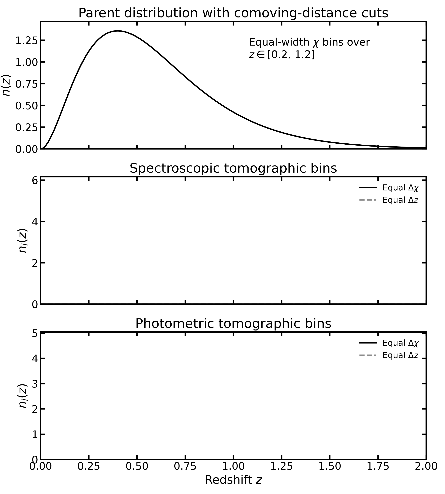
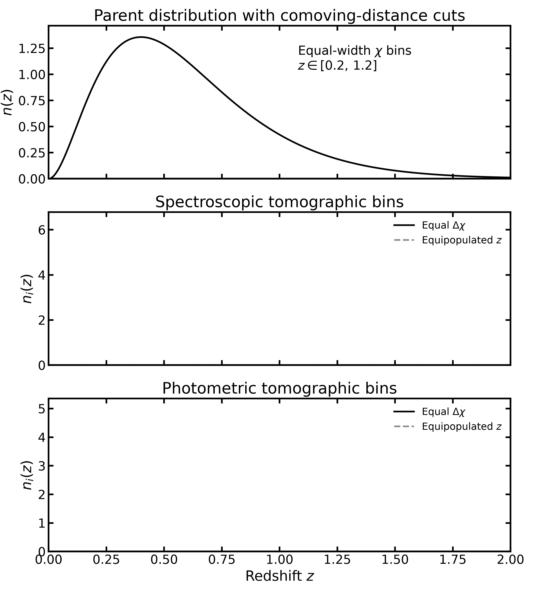

.. |logo| image:: ../../_static/assets/logo.png
   :alt: logo
   :width: 32px

|logo| Binning schemes
======================

This page demonstrates how to configure and use the binning
prescriptions available in Binny.

For mathematical definitions and explanations of the individual
schemes, see :doc:`../../theory/binning_schemes`.

All examples use the unified ``bins`` dictionary.

Preparing a parent distribution
-------------------------------

We begin with a synthetic parent redshift distribution.

.. code-block:: python

   import numpy as np

   from binny.binning import resolve_bin_edges

   z = np.linspace(0.0, 3.0, 501)
   nz = z**2 * np.exp(-z / 0.5)

The array ``z`` defines the redshift grid, while ``nz`` contains
the corresponding parent distribution.

.. note::

   **The input grid is not the binning interval.**

   In the examples below, the parent distribution is defined
   over :math:`0 \leq z \leq 3`.

   We can construct bins over the full interval or restrict
   them to a smaller interval without redefining ``z`` or ``nz``.

.. _example-explicit-edges:

Explicit bin edges
------------------

When the bin boundaries are already known, supply them directly.

.. code-block:: python

   bins = {
       "edges": [0.2, 0.4, 0.6, 0.8, 1.0, 1.2],
   }

   edges = resolve_bin_edges(
       axis=z,
       density=nz,
       bins=bins,
   )

   print(edges)

The supplied boundaries are returned directly after validation.

Explicit edges must be strictly increasing.

Do not combine ``edges`` with ``scheme``, ``n_bins``,
``range``, or ``segments``.

.. _example-generated-edges:

Generated bin edges
-------------------

Generated binning requires a named scheme and the number of bins.

For example:

.. code-block:: python

   bins = {
       "scheme": "equidistant",
       "n_bins": 5,
   }

   edges = resolve_bin_edges(
       axis=z,
       density=nz,
       bins=bins,
   )

   print(edges)

Because no ``range`` is specified, the full interval of the
input redshift grid is used.

Restricting the binning interval
~~~~~~~~~~~~~~~~~~~~~~~~~~~~~~~~

To construct bins over only part of the input grid, supply
``range`` inside ``bins``.

.. code-block:: python

   bins = {
       "scheme": "equidistant",
       "n_bins": 5,
       "range": [0.2, 1.2],
   }

   edges = resolve_bin_edges(
       axis=z,
       density=nz,
       bins=bins,
   )

   print(edges)

The result is

.. code-block:: text

   [0.2 0.4 0.6 0.8 1.0 1.2]

The original ``z`` and ``nz`` arrays remain unchanged.

Only the interval over which bin edges are generated is restricted.

.. _example-equidistant:

Equidistant binning
-------------------

Equidistant binning creates bins with equal redshift widths.

.. code-block:: python

   bins = {
       "scheme": "equidistant",
       "n_bins": 5,
       "range": [0.2, 1.2],
   }

   edges = resolve_bin_edges(
       axis=z,
       density=nz,
       bins=bins,
   )

   print(edges)

The alias ``eq`` or ``linear`` can be used instead of
``equidistant``.

For the mathematical definition, see
:ref:`theory-equidistant`.

.. _example-equal-number:

Equal-number binning
--------------------

Equal-number binning places boundaries so that every bin
contains the same integrated population.

.. code-block:: python

   bins = {
       "scheme": "equal_number",
       "n_bins": 5,
       "range": [0.2, 1.2],
   }

   edges = resolve_bin_edges(
       axis=z,
       density=nz,
       bins=bins,
   )

   print(edges)

The resulting bins generally have different redshift widths.

The aliases ``equipopulated`` and ``en`` are equivalent to
``equal_number``.

For the mathematical definition, see
:ref:`theory-equal-number`.

.. _example-generalized:

Generalized binning
-------------------

Generalized binning allows the user to interpolate between
different binning prescriptions through the parameters
``alpha`` and ``beta``.

For example, with :math:`\alpha=0.5` and :math:`\beta=0`:

.. code-block:: python

   bins = {
       "scheme": "generalized",
       "n_bins": 5,
       "params": {
           "alpha": 0.5,
           "beta": 0.0,
       },
   }

   edges = resolve_bin_edges(
       axis=z,
       density=nz,
       bins=bins,
   )

   print(edges)

Scheme-specific arguments must be nested inside ``params``.

Generalized binning with comoving distance
~~~~~~~~~~~~~~~~~~~~~~~~~~~~~~~~~~~~~~~~~~

When :math:`\beta \neq 0`, the generalized prescription
requires comoving-distance information.

Suppose ``chi`` contains the comoving radial distance
evaluated on the same grid as ``z``.

.. code-block:: python

   import pyccl as ccl

   cosmo = ccl.CosmologyVanillaLCDM()
   chi = ccl.comoving_radial_distance(
       cosmo,
       1.0 / (1.0 + z),
   )

.. note::

   PyCCL is used here to calculate the comoving-distance
   relation. It is not required by Binny's bin-edge
   construction functions, which accept precomputed
   comoving-distance arrays.

The underlying numerical function can be called directly:

.. code-block:: python

   from binny.axes.bin_edges import generalized_tomographic_edges

   edges = generalized_tomographic_edges(
       z,
       nz,
       n_bins=5,
       alpha=0.5,
       beta=1.0,
       comoving_distance=chi,
   )

Alternatively, use the unified bin specification:

.. code-block:: python

   bins = {
       "scheme": "generalized",
       "n_bins": 5,
       "params": {
           "alpha": 0.5,
           "beta": 1.0,
           "comoving_distance": chi,
       },
   }

   edges = resolve_bin_edges(
       axis=z,
       density=nz,
       bins=bins,
   )

When ``range`` is specified, the resolver interpolates
the comoving-distance samples onto the restricted grid.

For the mathematical definition, see
:ref:`theory-generalized`.

.. _example-comoving-distance:

Comoving-distance binning
-------------------------

Binny supports equal-width comoving-distance binning through
:func:`binny.axes.bin_edges.equidistant_chi_edges`.

Unlike equidistant redshift binning, this prescription
constructs boundaries uniformly in comoving radial distance
and returns the corresponding redshift edges.

Using the fiducial cosmology defined in the preceding example,
we can compare equal-width comoving-distance, equal-width
redshift, and equipopulated binning.

.. code-block:: python

   from binny.axes import (
       equidistant_chi_edges,
       equidistant_edges,
       equal_number_edges,
   )

For example, construct four bins over
:math:`0.2 \leq z \leq 1.2`.

.. code-block:: python

   z_fine = np.linspace(0.2, 1.2, 10000)
   nz_fine = np.interp(z_fine, z, nz)
   chi_fine = ccl.comoving_radial_distance(
       cosmo,
       1.0 / (1.0 + z_fine),
   )

   chi_z_edges = equidistant_chi_edges(
       z_fine,
       chi_fine,
       n_bins=4,
   )

   equal_z_edges = equidistant_edges(0.2, 1.2, n_bins=4)

   equipopulated_z_edges = equal_number_edges(
       z_fine,
       nz_fine,
       n_bins=4,
   )

   print("Equal-width chi:", chi_z_edges)
   print("Equal-width z:", equal_z_edges)
   print("Equipopulated z:", equipopulated_z_edges)

All three arrays contain redshift boundaries.
Only the prescription used to construct them differs.

Equal-width comoving distance versus redshift
~~~~~~~~~~~~~~~~~~~~~~~~~~~~~~~~~~~~~~~~~~~~~

The following animation compares equal-width comoving-distance
bins (colored regions) against equal-width redshift bins
(gray dashed curves).

Equal-width comoving distance versus equipopulated bins
~~~~~~~~~~~~~~~~~~~~~~~~~~~~~~~~~~~~~~~~~~~~~~~~~~~~~~~

The following animation compares equal-width comoving-distance
bins (colored regions) against equipopulated redshift bins
(gray dashed curves).

Both animations show the parent distribution, spectroscopic
tomography, and photometric tomography.

The binning prescription determines the boundaries, while
the tomography kind determines how galaxies are assigned
to the bins.

For the mathematical explanation and the relation to
generalized binning, see :ref:`theory-comoving-distance`.

.. _example-mixed-binning:

Mixed binning
-------------

Mixed binning combines multiple schemes across adjacent
redshift intervals.

For example, use two equidistant bins at low redshift
and three equal-number bins at higher redshift.

.. code-block:: python

   bins = {
       "segments": [
           {
               "scheme": "equidistant",
               "n_bins": 2,
               "x_min": 0.2,
               "x_max": 0.6,
           },
           {
               "scheme": "equal_number",
               "n_bins": 3,
               "x_min": 0.6,
               "x_max": 1.2,
           },
       ],
   }

   edges = resolve_bin_edges(
       axis=z,
       density=nz,
       bins=bins,
   )

   print(edges)

The resulting array contains six boundaries defining
five tomographic bins.

The shared boundary at :math:`z=0.6` is included only once.

For the theoretical description, see
:ref:`theory-mixed-binning`.

.. _example-custom-scheme:

Custom binning schemes
----------------------

Binny allows users to register their own binning schemes
and use them through the same interface as built-in schemes.

The following example creates a power-law mapping of
uniformly spaced coordinates into bin edges.

.. code-block:: python

   import numpy as np

   from binny.binning import (
       available_binning_schemes,
       get_binning_scheme,
       register_binning_scheme,
       resolve_bin_edges,
   )

   @register_binning_scheme("custom_power")
   def custom_power(axis, density, n_bins, *, power=2.0):
       """Construct power-law-spaced bin edges."""
       u = np.linspace(0.0, 1.0, n_bins + 1)
       return axis[0] + (axis[-1] - axis[0]) * u**power

   axis = np.linspace(0.0, 3.0, 1000)
   density = np.exp(-axis)

   edges = resolve_bin_edges(
       axis=axis,
       density=density,
       bins={
           "scheme": "custom_power",
           "n_bins": 5,
           "params": {"power": 2.0},
       },
   )

   print(edges)
   print(available_binning_schemes())

The returned boundaries are

.. code-block:: text

   [0.   0.12 0.48 1.08 1.92 3.  ]

The custom scheme is now registered under the name
``custom_power`` and can be selected just like any
built-in scheme.

Inspecting registered schemes
~~~~~~~~~~~~~~~~~~~~~~~~~~~~~

The registry provides functions for discovering available
schemes and retrieving registered implementations.

.. code-block:: python

   schemes = available_binning_schemes()
   print(schemes)

   scheme_function = get_binning_scheme("custom_power")
   print(scheme_function)

Custom scheme names are case-insensitive.

Duplicate names are rejected.

Scheme-specific parameters are supplied through ``params``
and validated against the registered function's signature.

Survey YAML configurations
--------------------------

The same ``bins`` structure can be used in survey presets.

For example:

.. code-block:: yaml

   tomography:
     - role: lens
       kind: photoz

       nz:
         model: smail
         params:
           z0: 0.5
           alpha: 2.0
           beta: 1.0

       bins:
         scheme: generalized
         n_bins: 5
         params:
           alpha: 0.5
           beta: 0.0

       uncertainties:
         scatter_scale: 0.05
         mean_offset: 0.0

       normalize_bins: true

The parameters under ``nz`` describe the parent distribution.

The parameters under ``bins`` describe the binning prescription.

The uncertainty model is configured independently.

See also
--------

- :doc:`../../theory/binning_schemes`
- :doc:`photoz_bins`
- :doc:`specz_bins`
- :doc:`../../theory/tomography`
- :mod:`binny.binning.edges`
