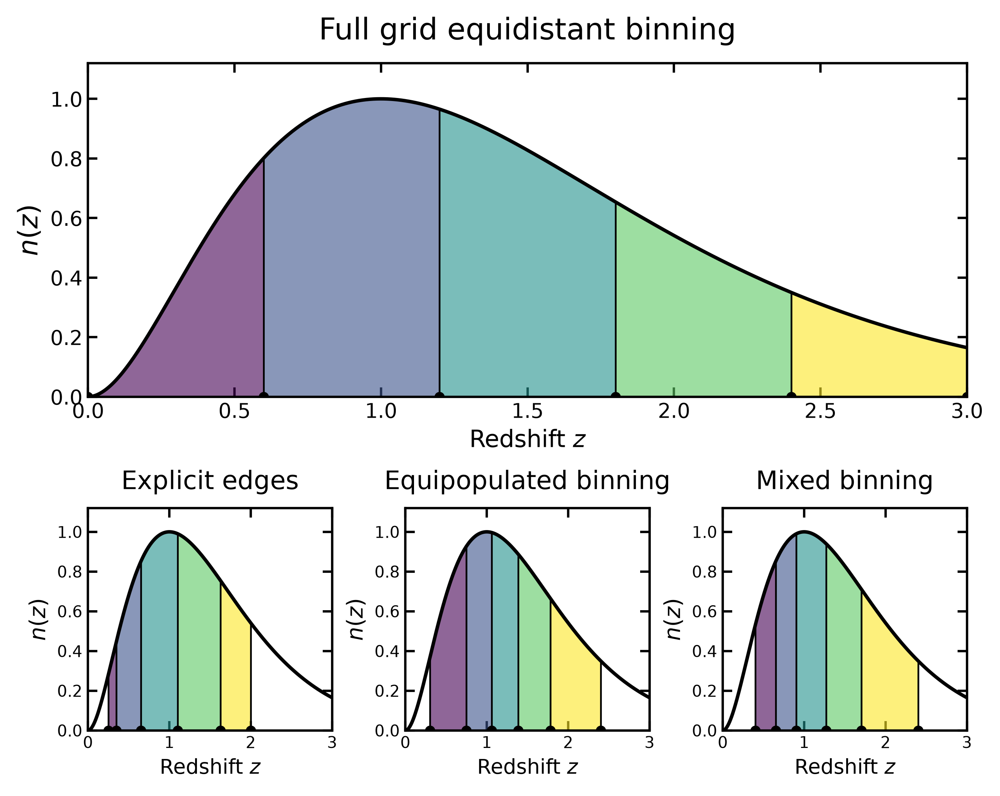
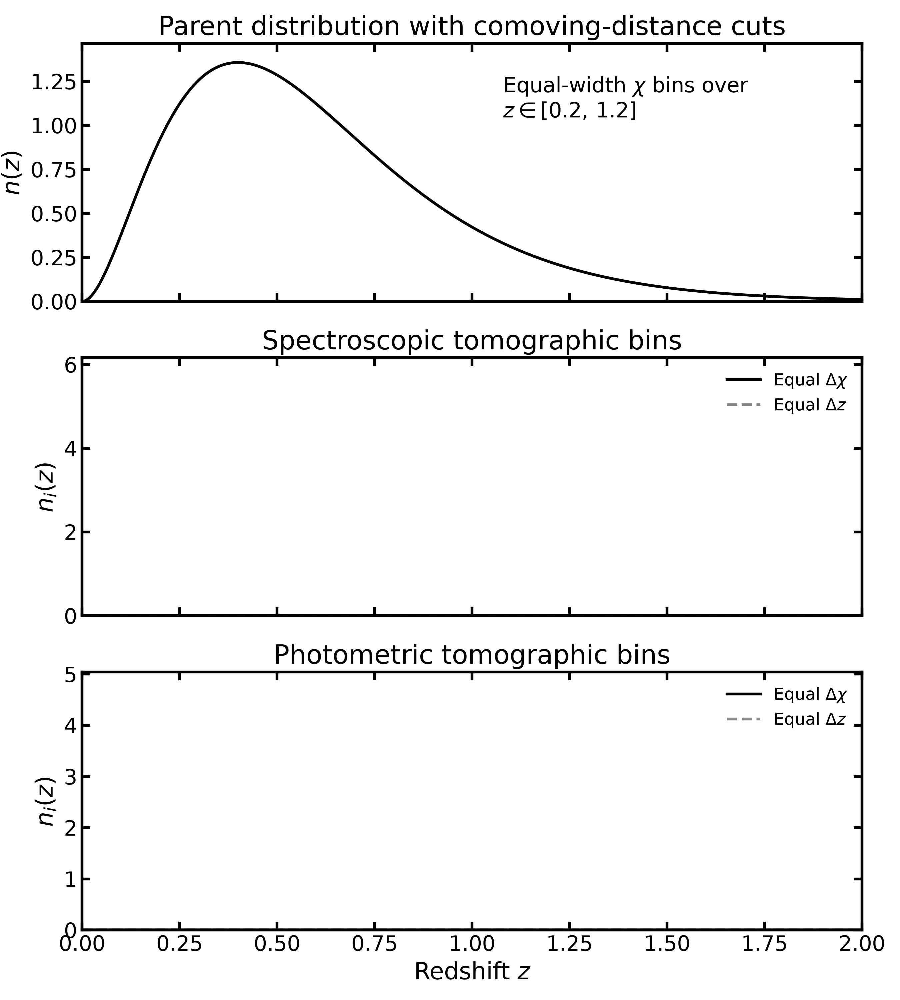
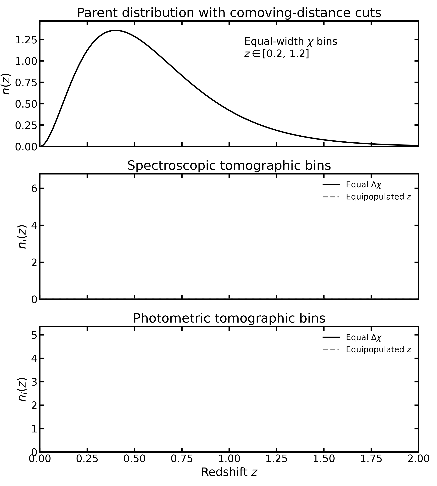

.. |logo| image:: ../../_static/assets/logo.png
   :alt: logo
   :width: 32px

|logo| Binning schemes
======================

Binny supports several prescriptions for constructing bin edges
along a numerical coordinate.

Although the primary application of Binny is cosmological tomography,
the underlying binning algorithms are not restricted to redshift.

A binning scheme determines where the bin boundaries are placed.
The assignment model (for example, ``photoz`` or ``specz`` in
redshift tomography) determines how objects are assigned to those
bins.

These are distinct choices: the same binning scheme can be used
with different assignment models.

Some binning prescriptions depend only on the coordinate interval
and the requested number of bins, while others depend on the
underlying population distribution or additional weight functions.

For practical configurations and executable examples, see
:doc:`/examples/binning/binning_schemes`.

Binning coordinates
-------------------

Following the notation introduced in :doc:`/theory/conventions`,
a general numerical coordinate is denoted by :math:`x`.

The coordinate may represent, for example,

- true redshift,
- observed redshift,
- comoving radial distance,
- magnitude,
- luminosity,
- mass,
- another numerical quantity.

A distribution defined along this coordinate is denoted by

.. math::

   n_x(x).

When this distribution represents a population density per unit
coordinate, the population within an interval is proportional to

.. math::

   \int_{x_{\min}}^{x_{\max}}
   n_x(x)\,\mathrm{d}x.

For :math:`N_{\mathrm{bins}}` consecutive bins, the bin boundaries
are written as

.. math::

   e_0 < e_1 < \cdots < e_{N_{\mathrm{bins}}}.

The nominal interval associated with bin :math:`i` is

.. math::

   [e_i, e_{i+1}).

The binning coordinate determines the intervals used for selection,
but does not necessarily determine the coordinate on which the
resulting distributions are evaluated.

For example, photometric tomographic bins are commonly defined in
observed redshift :math:`z_{\mathrm{obs}}`, while their resulting
redshift distributions are evaluated on the true-redshift grid
:math:`z`.

The relation between these coordinates is determined by the
assignment model.

The generic edge-generation algorithms can operate on arbitrary
numerical coordinates, whereas the tomography construction
machinery represents the resulting populations through their
redshift distributions.

Coordinate grid and binning interval
------------------------------------

.. note::

   **The coordinate grid and the binning interval are different things.**

   The input coordinate grid (``z`` in redshift tomography, or
   ``axis`` in the edge resolver) specifies the coordinate values
   at which the input distribution is evaluated.

   By default, generated binning schemes use the full range of
   the supplied coordinate grid, unless an alternative binning
   domain is supplied.

   To restrict binning to a smaller interval, specify ``range``
   inside the ``bins`` dictionary.

   Alternatively, use ``edges`` to provide the exact bin boundaries
   without selecting a generating scheme.

   **Restricting the binning interval does not redefine the input
   coordinate grid or the parent distribution.**

For example, a parent redshift distribution defined over
:math:`0 \leq z \leq 3` may be divided into five bins covering
the entire grid or a restricted interval, such as
:math:`0.3 \leq z \leq 2.4`.

The parent distribution remains defined over its original grid,
while the binning prescription determines the interval and placement
of the bin boundaries.

The boundaries do not necessarily coincide with points on the
input grid.

The figure below illustrates four ways of constructing five tomographic
bins from the same parent redshift distribution.

The upper panel shows equidistant binning over the full input grid.
The lower panels show explicitly specified boundaries, equipopulated
binning over a restricted interval, and mixed binning combining
equidistant and equipopulated segments.

In all cases, the parent distribution remains unchanged; only the
bin boundaries and the interval covered by the bins differ.

Binning modes
-------------

Binny supports three mutually exclusive ways of specifying bin edges:

- **Explicit edges:** the boundaries are supplied directly.
- **Generated edges:** a named scheme generates a requested number
  of bins.
- **Mixed binning:** multiple schemes are combined over adjacent
  coordinate intervals.

All three modes use the same ``bins`` specification.

For generated binning, the number of bins is specified by
``n_bins``, while the optional ``range`` defines the interval
``[x_min, x_max]`` over which the boundaries are constructed.

If ``range`` is omitted, the full range of the relevant input
coordinate grid is used.

For explicit binning, ``edges`` directly specifies all
boundaries, including the lower and upper limits.
Neither ``n_bins`` nor ``range`` should be supplied alongside
``edges``.

These options are mutually exclusive rather than overriding
one another.

The central resolver is
:func:`binny.binning.edges.resolve_bin_edges`.

Explicit bin edges
~~~~~~~~~~~~~~~~~~

Explicit binning uses a supplied sequence of bin boundaries rather
than generating them from a mathematical prescription.

For :math:`N_{\mathrm{bins}}` bins, the specification must contain
:math:`N_{\mathrm{bins}}+1` strictly increasing edges,

.. math::

   e_0 < e_1 < \cdots < e_{N_{\mathrm{bins}}}.

This mode does not accept a generating scheme, a separate number
of bins, or an additional binning range.

See :ref:`example-explicit-edges` for a practical example.

Generated bin edges
~~~~~~~~~~~~~~~~~~~

Generated binning uses a named mathematical prescription to divide
a specified interval into :math:`N_{\mathrm{bins}}` bins.

The binning interval is

.. math::

   x_{\min} \leq x \leq x_{\max}.

If no interval is explicitly requested, the full range of the
relevant input coordinate grid is used.

A generated specification contains:

- ``scheme``: the name of the binning prescription.
- ``n_bins``: the requested number of bins.
- ``range``: an optional interval for constructing the edges.
- ``params``: optional parameters specific to the selected scheme.

Scheme-specific parameters belong inside ``params``, rather than
at the top level of the bin specification.

Unsupported scheme parameters raise a ``ValueError``.

See :ref:`example-generated-edges`.

Built-in binning schemes
------------------------

The following schemes are registered by default.

.. list-table::
   :header-rows: 1
   :widths: 25 30 45

   * - Scheme
     - Aliases
     - Description
   * - ``equidistant``
     - ``eq``, ``eq_dist``, ``linear``
     - Equal-width coordinate intervals.
   * - ``equal_number``
     - ``equipopulated``, ``en``
     - Equal integrated population per bin.
   * - ``generalized``
     - None
     - Equal integrated generalized weight per bin.
   * - ``logarithmic``
     - ``log``
     - Uniform spacing in the logarithm of the coordinate.
   * - ``geometric``
     - ``geom``
     - Constant ratio between consecutive boundaries.
   * - ``power``
     - None
     - Coordinate spacing controlled by a power-law exponent.
   * - ``chebyshev``
     - None
     - Boundaries concentrated towards both interval endpoints.
   * - ``sinh``
     - None
     - Adjustable concentration towards the midpoint or endpoints.
   * - ``equal_information``
     - None
     - Equal integrated information weight per bin.

The registered names and aliases can be inspected using
:func:`binny.binning.scheme_registry.available_binning_schemes`.

In the following sections, :math:`N_{\mathrm{bins}}` denotes the
number of bins and :math:`e_i` denotes the bin boundaries.

.. _theory-equidistant:

Equidistant binning
~~~~~~~~~~~~~~~~~~~

Equidistant binning divides the requested coordinate interval into
equal-width bins.

For an interval from :math:`x_{\min}` to :math:`x_{\max}`,
the boundaries are

.. math::

   e_i =
   x_{\min}
   + \frac{i}{N_{\mathrm{bins}}}
   (x_{\max}-x_{\min}),
   \qquad i=0,\ldots,N_{\mathrm{bins}}.

Every bin has the same coordinate width,

.. math::

   \Delta x =
   \frac{x_{\max}-x_{\min}}{N_{\mathrm{bins}}}.

The boundaries depend only on the requested interval and the
number of bins.
They do not depend on the underlying population distribution.

In redshift tomography, this corresponds to equal-width
redshift bins.

The underlying function is
:func:`binny.axes.bin_edges.equidistant_edges`.

.. _theory-equal-number:

Equal-number binning
~~~~~~~~~~~~~~~~~~~~

Equal-number binning selects boundaries such that each coordinate
interval contains the same integrated population according to the
supplied distribution.

For a distribution :math:`n_x(x)`, the boundaries satisfy

.. math::

   \int_{e_i}^{e_{i+1}}
   n_x(x)\,\mathrm{d}x
   =
   \frac{1}{N_{\mathrm{bins}}}
   \int_{x_{\min}}^{x_{\max}}
   n_x(x)\,\mathrm{d}x.

Unlike equidistant binning, the resulting bin widths generally
vary with the coordinate.

Regions with higher population density receive narrower bins,
while regions with lower population density receive wider bins.

Equivalently, defining the cumulative population as

.. math::

   F(x) =
   \frac{
      \int_{x_{\min}}^x
      n_x(x')\,\mathrm{d}x'
   }{
      \int_{x_{\min}}^{x_{\max}}
      n_x(x')\,\mathrm{d}x'
   },

the boundaries correspond to equally spaced cumulative
population fractions,

.. math::

   F(e_i) = \frac{i}{N_{\mathrm{bins}}}.

The distribution does not need to have unit normalization before
constructing the boundaries.

The alias ``equipopulated`` is equivalent to ``equal_number``.

The resolver can also use a separate distribution for determining
equal-number boundaries through ``equal_number_axis`` and
``equal_number_weights``.

This is useful when the distribution used to construct the
boundaries differs from the parent distribution used to construct
the tomographic populations.

For example, boundaries may be determined using an observed-redshift
distribution while the resulting tomographic distributions are
evaluated in true redshift.

.. note::

   Equal-number boundaries guarantee equal integrated population
   according to the distribution used to construct them, within
   numerical accuracy.

   They do not necessarily guarantee equal population fractions
   in the final tomographic distributions after measurement
   uncertainties, incompleteness, or other selection effects
   have been applied.

The underlying function is
:func:`binny.axes.bin_edges.equal_number_edges`.

See :ref:`example-equal-number`.

.. _theory-generalized:

Generalized binning
~~~~~~~~~~~~~~~~~~~

Generalized binning constructs boundaries by integrating a weight
function that depends on the supplied population distribution and,
optionally, the comoving radial distance.

For redshift tomography, the generalized weight is

.. math::

   w(z) =
   [n(z)]^\alpha
   \left(
   \frac{\mathrm{d}\chi}{\mathrm{d}z}
   \right)^\beta,

where :math:`\chi(z)` is the comoving radial distance and
:math:`\alpha` and :math:`\beta` are configurable exponents.

The corresponding boundaries satisfy

.. math::

   \int_{e_i}^{e_{i+1}} w(z)\,\mathrm{d}z
   =
   \frac{1}{N_{\mathrm{bins}}}
   \int_{z_{\min}}^{z_{\max}} w(z)\,\mathrm{d}z.

More generally, for a numerical coordinate :math:`x`, the
weight can be written as

.. math::

   w(x) =
   [n_x(x)]^\alpha
   \left(
   \frac{\mathrm{d}\chi}{\mathrm{d}x}
   \right)^\beta,

provided that the supplied distance-coordinate relation is
appropriate for the application.

This prescription contains several familiar binning strategies
as special cases.

.. list-table::
   :header-rows: 1
   :widths: 20 20 60

   * - :math:`\alpha`
     - :math:`\beta`
     - Interpretation
   * - 0
     - 0
     - Equidistant coordinate binning.
   * - 1
     - 0
     - Equal-number binning.
   * - 0
     - 1
     - Equal comoving-distance binning.

Intermediate exponent values allow bin boundaries to interpolate
between these prescriptions.

The exponent :math:`\alpha` controls the contribution of the
population density to the generalized weight.

The exponent :math:`\beta` controls the contribution of the
distance-coordinate relation.

When :math:`\alpha=0`, the population-density factor is
independent of the supplied distribution.

When :math:`\beta=0`, comoving-distance information is unnecessary.

The generalized weight must be finite, non-negative, and have
a positive total integral over the binning interval.

Negative values of :math:`\alpha` require a strictly positive
population density.

For nonzero :math:`\beta`, the underlying
:func:`binny.axes.bin_edges.generalized_tomographic_edges`
function requires comoving-distance samples evaluated on the
same coordinate grid.

The comoving-distance array must be finite, strictly increasing,
and compatible with the input coordinate grid.

The distance derivative used in the generalized weight must
be positive.

When a restricted binning interval is specified, the resolver
interpolates the comoving-distance samples onto the restricted grid.

The scheme-specific parameters are

- ``alpha``: population-density exponent.
- ``beta``: distance-derivative exponent.
- ``comoving_distance``: sampled comoving-distance array.
- ``derivative_method``: method used to evaluate the distance
  derivative.

The available derivative methods are ``analytic`` and ``numerical``.

See :ref:`example-generalized`.

Logarithmic binning
~~~~~~~~~~~~~~~~~~~

Logarithmic binning constructs boundaries that are uniformly
spaced in the logarithm of the coordinate.

For a strictly positive coordinate interval, the boundaries
satisfy

.. math::

   \ln e_i =
   \ln x_{\min}
   +
   \frac{i}{N_{\mathrm{bins}}}
   \ln\left(\frac{x_{\max}}{x_{\min}}\right).

Equivalently,

.. math::

   e_i =
   x_{\min}
   \left(
   \frac{x_{\max}}{x_{\min}}
   \right)^{i/N_{\mathrm{bins}}}.

The resulting bins have smaller absolute widths towards the
lower boundary and larger widths towards the upper boundary.

This prescription is useful for quantities spanning several
orders of magnitude, such as masses and luminosities.

The binning interval must have strictly positive endpoints.

The underlying function is
:func:`binny.axes.bin_edges.log_edges`.

Geometric binning
~~~~~~~~~~~~~~~~~

Geometric binning constructs boundaries with a constant ratio
between consecutive values.

Defining

.. math::

   r =
   \left(
   \frac{x_{\max}}{x_{\min}}
   \right)^{1/N_{\mathrm{bins}}},

the boundaries are

.. math::

   e_i = x_{\min} r^i.

Consequently,

.. math::

   \frac{e_{i+1}}{e_i} = r.

For strictly positive endpoints, geometric binning and logarithmic
binning are mathematically equivalent prescriptions.

They are exposed separately to accommodate the different
terminologies commonly used in numerical and scientific
applications.

The underlying function is
:func:`binny.axes.bin_edges.geometric_edges`.

Power-law binning
~~~~~~~~~~~~~~~~~

Power-law binning constructs boundaries using a nonlinear
transformation of a uniformly spaced coordinate.

Defining

.. math::

   t_i = \frac{i}{N_{\mathrm{bins}}},

the boundaries are

.. math::

   e_i =
   x_{\min}
   +
   (x_{\max}-x_{\min})t_i^p,

where :math:`p` is a positive power-law exponent.

The exponent controls where the boundaries are concentrated.

- :math:`p=1` corresponds to equidistant binning.
- :math:`p>1` concentrates boundaries towards the lower endpoint.
- :math:`0<p<1` concentrates boundaries towards the upper endpoint.

This prescription provides a simple way of controlling
asymmetric bin widths without requiring a population distribution.

The exponent is specified through the ``power`` parameter,
which defaults to ``2.0``.

The underlying function is
:func:`binny.axes.bin_edges.power_edges`.

Chebyshev binning
~~~~~~~~~~~~~~~~~

Chebyshev binning constructs boundaries using mapped
Chebyshev--Lobatto nodes.

The boundaries are given by

.. math::

   e_i =
   x_{\min}
   +
   \frac{x_{\max}-x_{\min}}{2}
   \left[
   1-\cos\left(
   \frac{\pi i}{N_{\mathrm{bins}}}
   \right)
   \right].

This produces narrower bins near both endpoints of the
coordinate interval and wider bins near its centre.

Unlike power-law binning, the concentration of boundaries
is symmetric about the midpoint.

The boundaries depend only on the requested interval and
the number of bins.

The underlying function is
:func:`binny.axes.bin_edges.chebyshev_edges`.

Sinh binning
~~~~~~~~~~~~

Sinh binning uses a nonlinear hyperbolic-sine-based coordinate
transformation to control the spacing of bin boundaries.

The prescription allows boundaries to be concentrated either
towards the midpoint of the coordinate interval or towards
its endpoints.

The scheme-specific parameters are

- ``strength``: controls the strength of the boundary concentration.
- ``concentration``: determines where the boundaries are concentrated.

The available concentration modes are

- ``midpoint``
- ``endpoints``

The default strength is ``3.0`` and the default concentration
mode is ``midpoint``.

Unlike equal-number binning, this prescription controls the
placement of boundaries directly through the coordinate
transformation rather than through the population distribution.

The underlying function is
:func:`binny.axes.bin_edges.sinh_edges`.

Equal-information binning
~~~~~~~~~~~~~~~~~~~~~~~~~

Equal-information binning constructs boundaries such that
each bin contains the same integrated information weight.

Let :math:`I(x)` denote a supplied non-negative information
density or scientific weighting function.

The boundaries satisfy

.. math::

   \int_{e_i}^{e_{i+1}}
   I(x)\,\mathrm{d}x
   =
   \frac{1}{N_{\mathrm{bins}}}
   \int_{x_{\min}}^{x_{\max}}
   I(x)\,\mathrm{d}x.

This prescription is mathematically analogous to equal-number
binning, but replaces the population density with a user-defined
information density.

Regions with larger information density receive narrower bins,
while regions with smaller information density receive wider bins.

The information density is supplied through the ``info_density``
parameter.

It must correspond to the coordinate grid used to construct
the boundaries.

If a restricted binning interval is used, the supplied information
density must be compatible with the restricted coordinate grid.

.. note::

   Binny does not prescribe a particular definition of information.

   The information density may be constructed externally from
   scientific sensitivity estimates, statistical weights, forecast
   diagnostics, or other quantities relevant to the application.

   Equal integrated information weights do not necessarily imply
   equal Fisher information or equal constraining power in a
   subsequent cosmological analysis, particularly when bins
   are statistically correlated.

The underlying function is
:func:`binny.axes.bin_edges.equal_information_edges`.

.. _theory-comoving-distance:

Comoving-distance binning
~~~~~~~~~~~~~~~~~~~~~~~~~

Tomographic bins can be constructed using comoving radial distance
rather than redshift.

This approach is discussed by Moskowitz et al. (2023),
`Improved Tomographic Binning of 3x2pt Lens Samples
<https://arxiv.org/abs/2212.06754>`_, who compare equal-width
redshift bins, equal-width comoving-distance bins, and
equipopulated bins.

They find that equal-width comoving-distance bins provide the
highest dark energy figure of merit among their initial
binning prescriptions, although further optimization of the
bin boundaries can improve the constraints.

For a specified cosmological model, the comoving radial distance
is

.. math::

   \chi(z) =
   c \int_0^z
   \frac{\mathrm{d}z'}{H(z')},

where :math:`c` is the speed of light and :math:`H(z)` is the
Hubble expansion rate.

Equal-width comoving-distance boundaries are defined by

.. math::

   \chi_i =
   \chi(z_{\min}) +
   \frac{i}{N_{\mathrm{bins}}}
   \left[\chi(z_{\max})-\chi(z_{\min})\right],
   \qquad i=0,\ldots,N_{\mathrm{bins}}.

The corresponding redshift boundaries are obtained by
inverting the distance-redshift relation,

.. math::

   e_i = \chi^{-1}(\chi_i).

Because :math:`\chi(z)` is nonlinear, equal-width
comoving-distance bins generally have unequal redshift
widths.

Unlike equidistant redshift binning, the resulting boundaries
depend on the cosmological model used to calculate the
distance-redshift relation.

In Binny, this prescription is implemented by
:func:`binny.axes.bin_edges.equidistant_chi_edges`.

It is also a special case of generalized binning,
corresponding to :math:`\alpha=0` and :math:`\beta=1`.

Comoving-distance binning is therefore not a separate registered
scheme, but is available through the dedicated low-level function
and the ``generalized`` binning prescription.

Equal-width redshift versus comoving-distance bins
^^^^^^^^^^^^^^^^^^^^^^^^^^^^^^^^^^^^^^^^^^^^^^^^^^

The following animation compares equal-width comoving-distance
bins (solid curves and colored regions) with equal-width
redshift bins (gray dashed curves).

Both prescriptions cover the same redshift interval, but
their internal boundaries differ because the comoving-distance
relation is nonlinear.

Comoving-distance versus equipopulated bins
^^^^^^^^^^^^^^^^^^^^^^^^^^^^^^^^^^^^^^^^^^^

Equal-number binning instead chooses boundaries such that
each bin contains the same integrated galaxy population
according to the supplied distribution,

.. math::

   \int_{e_i}^{e_{i+1}} n(z)\,\mathrm{d}z
   =
   \frac{1}{N_{\mathrm{bins}}}
   \int_{z_{\min}}^{z_{\max}} n(z)\,\mathrm{d}z.

Unlike equal-width comoving-distance binning, this
prescription depends on the parent redshift distribution.

The following animation compares equal-width comoving-distance
bins (solid curves and colored regions) with equipopulated
redshift bins (gray dashed curves).

For the illustrated example, four equipopulated bins are
constructed over :math:`0.2 \leq z \leq 1.2`.
Each contains approximately 25 percent of the population
within that interval.

Equal-number binning is invariant under an invertible monotonic
coordinate transformation when the number density is transformed
consistently,

.. math::

   n_\chi(\chi)\,\mathrm{d}\chi
   =
   n(z)\,\mathrm{d}z.

The corresponding comoving-distance distribution is

.. math::

   n_\chi(\chi) =
   n(z(\chi))
   \left|
   \frac{\mathrm{d}z}{\mathrm{d}\chi}
   \right|.

Consequently, equipopulated binning in comoving distance
and equipopulated binning in redshift yield the same
physical boundaries, up to numerical integration and
interpolation accuracy.

Equal-width binning, however, is coordinate-dependent.

In Binny, the two prescriptions are available through
:func:`binny.axes.bin_edges.equidistant_chi_edges`
and :func:`binny.axes.bin_edges.equal_number_edges`.

Coordinate transformations
--------------------------

The distinction between equal-width and equal-number binning
extends beyond redshift and comoving distance.

Consider a differentiable, strictly monotonic coordinate
transformation

.. math::

   y = g(x).

When transforming a population density from coordinate
:math:`x` to coordinate :math:`y`, the corresponding
distribution becomes

.. math::

   n_y(y) =
   n_x(g^{-1}(y))
   \left|
   \frac{\mathrm{d}x}{\mathrm{d}y}
   \right|.

For a monotonically increasing transformation, the integrated
population is preserved over corresponding intervals,

.. math::

   \int_{x_a}^{x_b}
   n_x(x)\,\mathrm{d}x
   =
   \int_{g(x_a)}^{g(x_b)}
   n_y(y)\,\mathrm{d}y.

Consequently, equal-number binning preserves the physical
partition of a population under such coordinate transformations.

In contrast, equal-width binning and other prescriptions
defined directly through coordinate spacing generally produce
different physical partitions when applied in different
coordinates.

When constructing boundaries using only coordinate spacing,
a population-density transformation is not required.

When constructing boundaries using integrated population
densities or weight functions, the corresponding density
must be expressed consistently with the coordinate over
which it is integrated.

.. _theory-mixed-binning:

Mixed binning
-------------

Mixed binning combines different binning prescriptions across
adjacent coordinate intervals.

Each segment specifies:

- A binning scheme.
- The number of bins in that segment.
- The lower and upper boundaries of the segment.
- Optional scheme-specific parameters.

The segment boundaries are specified through ``x_min`` and
``x_max``, while the number of bins is specified through
``n_bins``.

The total number of bins is the sum of the individual segment
counts,

.. math::

   N_{\mathrm{total}}
   =
   \sum_{s=1}^{N_{\mathrm{segments}}} N_s.

The resulting edges form one strictly increasing array.

Shared boundaries between adjacent segments are included only once.

Mixed binning uses the underlying
:func:`binny.axes.mixed_edges.mixed_edges` machinery.

Different segments may use different binning schemes or different
parameters for the same scheme.

For example, an interval may be divided into equidistant bins
at low redshift and equipopulated bins at high redshift.

For density-dependent segments, the input distribution is used
unless a separate selection distribution is provided through
``selection_axis`` and ``selection_density``.

In photometric-redshift tomography, these may represent the
observed-redshift grid and its corresponding distribution.

Equal-number segments can also use dedicated population inputs
through ``equal_number_axis`` and ``equal_number_weights``.

Equal-number binning within an individual segment equalizes the
population within that segment rather than across the complete
mixed binning configuration.

Consequently, a mixed prescription does not generally produce
equal population fractions across all bins.

See :ref:`example-mixed-binning`.

Custom binning schemes
----------------------

Binny supports user-defined binning prescriptions through a public
registry.

A custom scheme receives:

- The sampled coordinate axis.
- The corresponding density.
- The requested number of bins.
- Optional scheme-specific parameters.

It must return exactly :math:`N_{\mathrm{bins}}+1` strictly
increasing bin edges for :math:`N_{\mathrm{bins}}` requested bins.

Custom schemes use the same ``bins`` specification as built-in
schemes.

Scheme-specific arguments are supplied inside ``params`` and
validated against the registered function's signature.

Scheme names and aliases are case-insensitive.
Duplicate registered names are rejected.

The registry exposes:

- :func:`binny.binning.scheme_registry.register_binning_scheme`
- :func:`binny.binning.scheme_registry.get_binning_scheme`
- :func:`binny.binning.scheme_registry.available_binning_schemes`

A custom scheme determines the placement of bin boundaries.
It does not define how galaxies are assigned to those bins
or how the resulting tomographic distributions are normalized.

These operations are handled separately by the assignment
and tomography construction machinery.

See :ref:`example-custom-scheme` for registration and usage.

See also
--------

- :doc:`/theory/conventions`
- :doc:`/examples/binning/binning_schemes`
- :doc:`/examples/tomography/photoz_bins`
- :doc:`/examples/tomography/specz_bins`
- :doc:`/theory/tomography/tomography`
- :mod:`binny.binning`
- :mod:`binny.axes.bin_edges`