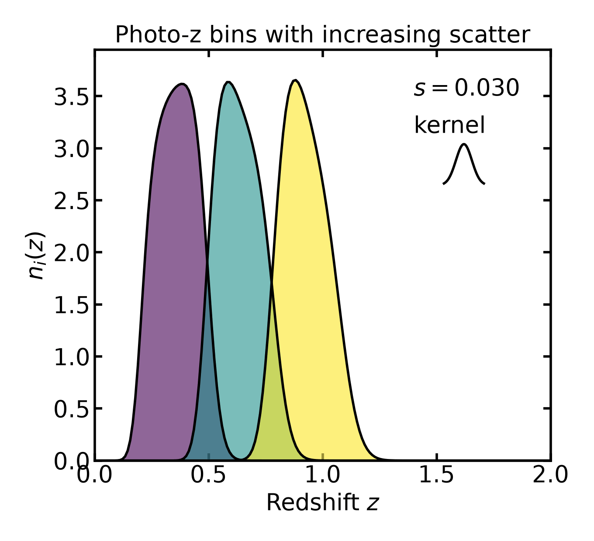
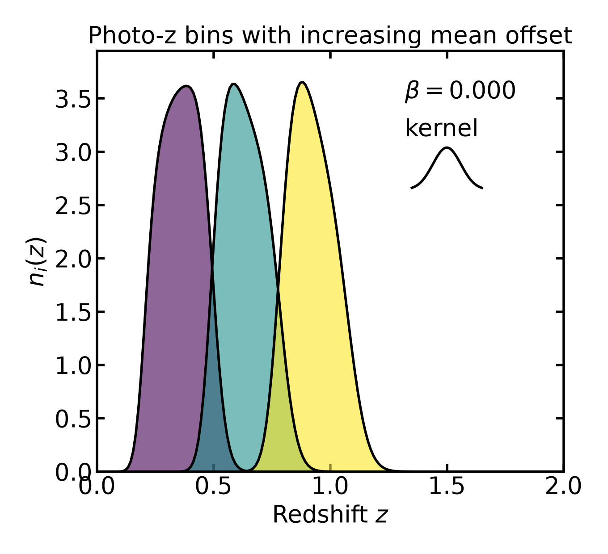
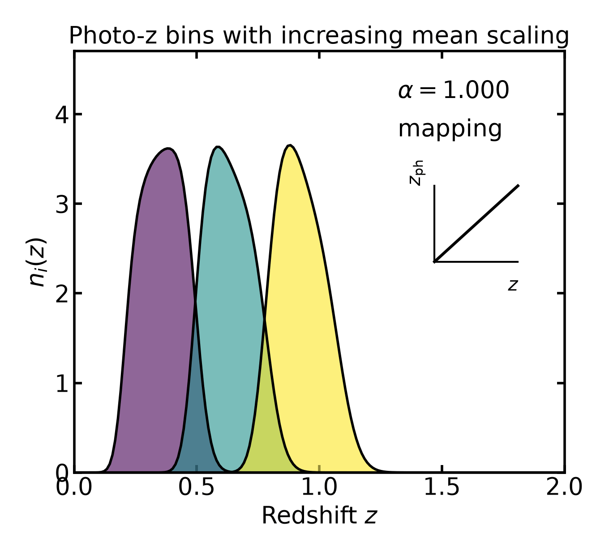
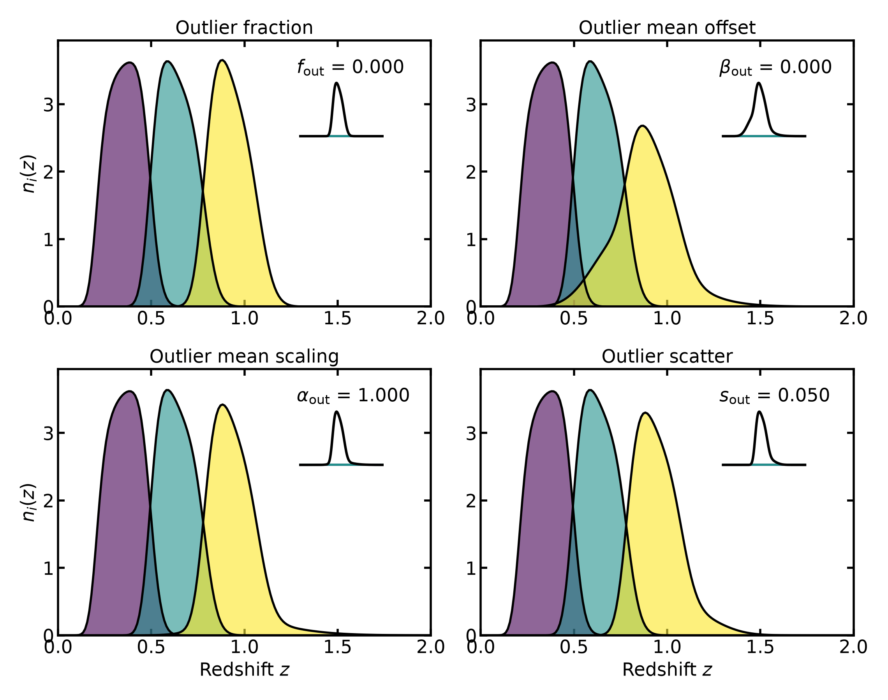

.. |logo| image:: ../../../_static/assets/logo.png
   :alt: logo
   :width: 32px

|logo| Photometric-redshift uncertainties
=========================================

In photometric-redshift tomography, bins are defined in observed photometric
redshift :math:`z_{\mathrm{ph}}`, but the resulting bin distributions are
evaluated on the true-redshift grid :math:`z`.

Following the general construction described in
:doc:`/theory/tomography/tomography`, the raw tomographic bin distribution is

.. math::

   n_i^{\mathrm{raw}}(z) = n(z)\,S_i(z),

where

- :math:`n(z)` is the parent redshift distribution,
- :math:`S_i(z)=P(i\mid z)` is the probability that a galaxy at true
  redshift :math:`z` is assigned to observed bin :math:`i`.

For observed-redshift bin edges :math:`e_i` and :math:`e_{i+1}`, the
assignment probability is

.. math::

   S_i(z)
   =
   \int_{e_i}^{e_{i+1}}
   p(z_{\mathrm{ph}}\mid z)\,\mathrm{d}z_{\mathrm{ph}},

where :math:`p(z_{\mathrm{ph}}\mid z)` is the conditional probability
density of observed photometric redshift at fixed true redshift.

Unlike deterministic true-redshift binning, photometric-redshift tomography
allows galaxies at the same true redshift to contribute probabilistically
to different observed bins.

Core Gaussian assignment
------------------------

The core photo-z model assumes a Gaussian conditional distribution,

.. math::

   z_{\mathrm{ph}}\mid z
   \sim
   \mathcal{N}\!\left(\mu(z),\sigma^2(z)\right),

with mean and scatter given by

.. math::

   \mu(z) = \alpha z-\beta,

.. math::

   \sigma(z) = s(1+z),

where

- :math:`\alpha` is the multiplicative mean-scaling parameter,
- :math:`\beta` is the mean-offset parameter,
- :math:`s` is the non-negative scatter amplitude.

For positive scatter, the conditional probability density is

.. math::

   p(z_{\mathrm{ph}}\mid z)
   =
   \frac{1}{\sqrt{2\pi}\,\sigma(z)}
   \exp\!\left[
      -\frac{(z_{\mathrm{ph}}-\mu(z))^2}{2\sigma^2(z)}
   \right].

Integrating this density over the observed bin interval gives the
analytic assignment probability,

.. math::

   S_i(z)
   =
   \frac{1}{2}
   \left[
      \operatorname{erf}\!\left(
         \frac{e_{i+1}-\mu(z)}{\sqrt{2}\,\sigma(z)}
      \right)
      -
      \operatorname{erf}\!\left(
         \frac{e_i-\mu(z)}{\sqrt{2}\,\sigma(z)}
      \right)
   \right],

where :math:`\operatorname{erf}` is the error function.

Binny evaluates this expression directly on the true-redshift grid,
avoiding numerical integration over observed redshift.

No-uncertainty limit
--------------------

When the scatter vanishes, :math:`s=0`, the core model reduces to a
deterministic mapping,

.. math::

   z_{\mathrm{ph}} = \mu(z) = \alpha z-\beta.

The corresponding conditional density is formally

.. math::

   p(z_{\mathrm{ph}}\mid z)
   =
   \delta_{\mathrm{D}}\!\left(z_{\mathrm{ph}}-\mu(z)\right),

where :math:`\delta_{\mathrm{D}}` is the Dirac delta function.

The assignment probability becomes

.. math::

   S_i(z)
   =
   \begin{cases}
      1, & e_i \le \mu(z) < e_{i+1}, \\
      0, & \text{otherwise}.
   \end{cases}

For positive mean scaling, the corresponding true-redshift interval is

.. math::

   \frac{e_i+\beta}{\alpha}
   \le z <
   \frac{e_{i+1}+\beta}{\alpha}.

The usual sharp true-redshift selection is recovered when

.. math::

   \alpha=1,
   \qquad
   \beta=0,
   \qquad
   s=0,
   \qquad
   f_{\mathrm{out}}=0,

where :math:`f_{\mathrm{out}}` is the outlier mixture fraction
introduced below.

These are the default parameter values in Binny.
The remaining outlier parameters have no effect when
:math:`f_{\mathrm{out}}=0`.

Photo-z uncertainty terms
-------------------------

Binny provides several uncertainty parameters that modify the conditional
relation between true and observed photometric redshift.

Scatter
^^^^^^^

The Gaussian scatter is parameterized as

.. math::

   \sigma(z)=s(1+z),

where :math:`s` controls the width of the conditional observed-redshift
distribution.

Increasing the scatter generally broadens the selection functions around
the nominal bin boundaries, increasing overlap between neighboring
tomographic bins.

The resulting bin shapes also depend on the parent redshift distribution
and the other uncertainty parameters.

API mapping:

- :math:`s`: ``scatter_scale``

Bias / mean offset
^^^^^^^^^^^^^^^^^^

The mean observed-redshift relation is

.. math::

   \mu(z)=\alpha z-\beta.

The conditional mean redshift error of the core component is therefore

.. math::

   \left\langle z_{\mathrm{ph}}-z\mid z\right\rangle
   =
   (\alpha-1)z-\beta.

For :math:`\alpha=1`, the mean redshift error is simply :math:`-\beta`.

A positive ``mean_offset`` decreases the mean observed redshift at fixed
true redshift.
For positive mean scaling and fixed observed-redshift boundaries, this
generally moves the selection toward higher true redshift.
A negative offset has the opposite effect.

API mapping:

- :math:`\beta`: ``mean_offset``

Mean scaling
^^^^^^^^^^^^

The multiplicative parameter :math:`\alpha` controls the slope of the
mean observed-redshift relation,

.. math::

   \mu(z)=\alpha z-\beta.

Changing :math:`\alpha` stretches or compresses the mapping between
true and observed redshift.

In the deterministic limit with :math:`\alpha>0`, the width of the
selected interval in true redshift is

.. math::

   \Delta z_i
   =
   \frac{e_{i+1}-e_i}{\alpha}.

Mean scaling therefore affects both the location and width of the
effective selection.

API mapping:

- :math:`\alpha`: ``mean_scale``

.. note::

   The ``mean_offset`` and ``mean_scale`` parameters act on the conditional
   observed-redshift relation, rather than directly shifting or stretching
   an already constructed tomographic redshift distribution.

   Because the raw bin distribution is the product of the parent
   distribution and the selection function, these parameters may change
   its location, width, shape, and integrated population simultaneously.

Outlier mixture
^^^^^^^^^^^^^^^

Binny supports a second Gaussian component representing catastrophic or
outlier-like photometric-redshift failures.

The conditional density becomes a mixture of a core and an outlier
component,

.. math::

   p(z_{\mathrm{ph}}\mid z)
   =
   (1-f_{\mathrm{out}})\,p_{\mathrm{core}}(z_{\mathrm{ph}}\mid z)
   +
   f_{\mathrm{out}}\,p_{\mathrm{out}}(z_{\mathrm{ph}}\mid z),

where

- :math:`p_{\mathrm{core}}` is the core Gaussian conditional density,
- :math:`p_{\mathrm{out}}` is the outlier Gaussian conditional density,
- :math:`f_{\mathrm{out}}\in[0,1]` is the outlier mixture fraction.

The corresponding selection function is

.. math::

   S_i(z)
   =
   (1-f_{\mathrm{out}})\,S_{i,\mathrm{core}}(z)
   +
   f_{\mathrm{out}}\,S_{i,\mathrm{out}}(z).

Both components use the analytic Gaussian assignment probability
described above, with their respective mean and scatter parameters.

The outlier component has its own conditional mean and scatter,

.. math::

   \mu_{\mathrm{out}}(z)
   =
   \alpha_{\mathrm{out}}z-\beta_{\mathrm{out}},

.. math::

   \sigma_{\mathrm{out}}(z)
   =
   s_{\mathrm{out}}(1+z),

where

- :math:`\alpha_{\mathrm{out}}` controls the outlier mean scaling,
- :math:`\beta_{\mathrm{out}}` controls the outlier mean offset,
- :math:`s_{\mathrm{out}}` controls the outlier scatter amplitude.

The outlier fraction determines the relative contribution of the two
components:

- :math:`f_{\mathrm{out}}=0`: core component only.
- :math:`0<f_{\mathrm{out}}<1`: mixture of core and outlier components.
- :math:`f_{\mathrm{out}}=1`: outlier component only.

Depending on the outlier parameters and the parent distribution, the
outlier contribution may appear as an extended tail, a broad shoulder,
or a separate secondary peak in the resulting tomographic bin.

API mapping:

- :math:`f_{\mathrm{out}}`: ``outlier_frac``
- :math:`\alpha_{\mathrm{out}}`: ``outlier_mean_scale``
- :math:`\beta_{\mathrm{out}}`: ``outlier_mean_offset``
- :math:`s_{\mathrm{out}}`: ``outlier_scatter_scale``

Outlier mixture fraction and selected population
~~~~~~~~~~~~~~~~~~~~~~~~~~~~~~~~~~~~~~~~~~~~~~~~

The outlier mixture fraction is not necessarily equal to the fraction
of outlier galaxies in a resulting tomographic bin.

For a common conditional mixture model, the integrated core and outlier
contributions are

.. math::

   A_{i,\mathrm{core}}
   =
   (1-f_{\mathrm{out}})
   \int n(z)\,S_{i,\mathrm{core}}(z)\,\mathrm{d}z,

.. math::

   A_{i,\mathrm{out}}
   =
   f_{\mathrm{out}}
   \int n(z)\,S_{i,\mathrm{out}}(z)\,\mathrm{d}z.

The fraction of selected galaxies belonging to the outlier component is

.. math::

   f_{i,\mathrm{out}}^{\mathrm{selected}}
   =
   \frac{A_{i,\mathrm{out}}}
        {A_{i,\mathrm{core}}+A_{i,\mathrm{out}}},

provided that the denominator is positive.

In general,

.. math::

   f_{i,\mathrm{out}}^{\mathrm{selected}}
   \neq f_{\mathrm{out}},

because the two components may assign galaxies to the same observed
bin with different probabilities.

This distinction concerns the mathematical interpretation of the
mixture model.

Implemented photo-z parameters
------------------------------

The following photometric-redshift uncertainty parameters are
implemented in Binny.

.. list-table::
   :header-rows: 1
   :widths: 22 33 45

   * - Parameter
     - API argument
     - Description
   * - :math:`s`
     - ``scatter_scale``
     - Core Gaussian scatter amplitude.
   * - :math:`\beta`
     - ``mean_offset``
     - Offset subtracted from the core mean relation.
   * - :math:`\alpha`
     - ``mean_scale``
     - Multiplicative scaling of the core mean relation.
   * - :math:`f_{\mathrm{out}}`
     - ``outlier_frac``
     - Outlier mixture fraction.
   * - :math:`s_{\mathrm{out}}`
     - ``outlier_scatter_scale``
     - Outlier Gaussian scatter amplitude.
   * - :math:`\beta_{\mathrm{out}}`
     - ``outlier_mean_offset``
     - Offset subtracted from the outlier mean relation.
   * - :math:`\alpha_{\mathrm{out}}`
     - ``outlier_mean_scale``
     - Multiplicative scaling of the outlier mean relation.

Each parameter may be supplied as a scalar or as a per-bin sequence.

Implemented photo-z parameters
------------------------------

The following photometric-redshift uncertainty parameters are
implemented in Binny.

.. list-table::
   :header-rows: 1
   :widths: 18 31 12 39

   * - Parameter
     - API argument
     - Default
     - Description
   * - :math:`s`
     - ``scatter_scale``
     - ``0.0``
     - Core Gaussian scatter amplitude.
   * - :math:`\beta`
     - ``mean_offset``
     - ``0.0``
     - Offset subtracted from the core mean relation.
   * - :math:`\alpha`
     - ``mean_scale``
     - ``1.0``
     - Multiplicative scaling of the core mean relation.
   * - :math:`f_{\mathrm{out}}`
     - ``outlier_frac``
     - ``0.0``
     - Outlier mixture fraction.
   * - :math:`s_{\mathrm{out}}`
     - ``outlier_scatter_scale``
     - ``None``
     - Outlier Gaussian scatter amplitude.
   * - :math:`\beta_{\mathrm{out}}`
     - ``outlier_mean_offset``
     - ``0.0``
     - Offset subtracted from the outlier mean relation.
   * - :math:`\alpha_{\mathrm{out}}`
     - ``outlier_mean_scale``
     - ``1.0``
     - Multiplicative scaling of the outlier mean relation.

Each parameter may be supplied as a scalar or as a per-bin sequence.

The outlier component is enabled only when ``outlier_frac > 0``.
In this case, an explicit non-negative ``outlier_scatter_scale``
must be supplied.
A value of ``0.0`` produces a deterministic outlier component.

Global and bin-dependent uncertainty parameters
-----------------------------------------------

When scalar parameters are supplied, all bins share the same conditional
redshift model.
Different bins correspond to different observed-redshift intervals of
that model.

When per-bin sequences are supplied, the uncertainty parameters may
differ independently between tomographic bins.

The parameter vector associated with bin :math:`i` is

.. math::

   \boldsymbol{\theta}_{\mathrm{ph},i}
   =
   \left(
      s_i,\beta_i,\alpha_i,
      f_{\mathrm{out},i},
      s_{\mathrm{out},i},
      \beta_{\mathrm{out},i},
      \alpha_{\mathrm{out},i}
   \right).

The corresponding selection function becomes

.. math::

   S_i(z)
   =
   \int_{e_i}^{e_{i+1}}
   p_i(z_{\mathrm{ph}}\mid z,\boldsymbol{\theta}_{\mathrm{ph},i})
   \,\mathrm{d}z_{\mathrm{ph}}.

This flexibility is particularly useful in forecasting and systematic
uncertainty studies where individual tomographic distributions may
be perturbed independently.

Population conservation
^^^^^^^^^^^^^^^^^^^^^^^

Each individual assignment probability satisfies

.. math::

   0 \le S_i(z) \le 1.

For a common conditional redshift model and contiguous,
non-overlapping observed-redshift bins,

.. math::

   \sum_{i=0}^{N_{\mathrm{bins}}-1} S_i(z)
   =
   \int_{e_0}^{e_{N_{\mathrm{bins}}}}
   p(z_{\mathrm{ph}}\mid z)\,\mathrm{d}z_{\mathrm{ph}}
   \le 1.

The sum is generally smaller than unity for finite observed-redshift
coverage, because some galaxies may fall outside the selected interval.

Equality requires that the selected intervals exhaust the support of
the conditional redshift distribution.

When uncertainty parameters differ independently between bins, the
selection functions need not correspond to a single common conditional
density.
Consequently, their sum may exceed unity.

.. note::

   Independent per-bin uncertainty parameters should be interpreted as
   effective tomographic selection models.
   They do not automatically define a population-conserving partition
   of the parent sample.

Normalization and interpretation
--------------------------------

The resulting photo-z bins are distributions on the true-redshift grid,
not histograms in observed photometric redshift.

As described in :doc:`/theory/tomography/tomography`, the raw bin integral is

.. math::

   A_i
   =
   \int n_i^{\mathrm{raw}}(z)\,\mathrm{d}z.

For a positive parent integral,

.. math::

   A=\int n(z)\,\mathrm{d}z,

the fractional population contribution is

.. math::

   f_i=\frac{A_i}{A}.

Independent bin normalization is controlled by ``normalize=True`` in
the core tomography builder and ``normalize_bins=True`` in the lower-level
photometric binning utilities.

For nonempty bins, the normalized distribution is

.. math::

   n_i(z)
   =
   \frac{n_i^{\mathrm{raw}}(z)}{A_i}.

The normalized curves retain their redshift shapes, while their relative
population information is retained in the metadata.

For the core tomography builder, the relevant metadata entries are
``metadata["parent_nz"]["norm"]``,
``metadata["bins"]["bins_norms"]``, and
``metadata["bins"]["frac_per_bin"]``.

For a common conditional model and non-overlapping observed-redshift
intervals, the population fractions satisfy

.. math::

   \sum_i f_i \le 1.

As discussed above, this condition is not automatically guaranteed for
independently specified per-bin uncertainty models.

Calibration of photo-z uncertainty parameters
---------------------------------------------

Photo-z uncertainty parameters may be specified directly or estimated
from matched reference and photometric redshift samples.

Binny provides utilities for fitting core-and-tail error models using
scaled redshift residuals,

.. math::

   r=\frac{z_{\mathrm{ph}}-z}{1+z}.

The fitted parameters can be converted into photo-z assignment parameters.
The calibration procedure and parameter conversion are described in
:doc:`/theory/calibration/photoz_fitting`.

See also
--------

- :doc:`/theory/binning/uncertainties/specz`
- :doc:`/theory/tomography/tomography`
- :doc:`/theory/calibration/photoz_fitting`
- :doc:`/theory/analysis/statistics`
- :doc:`/examples/tomography/photoz_bins`
- :doc:`/examples/calibration/photoz_fitting`