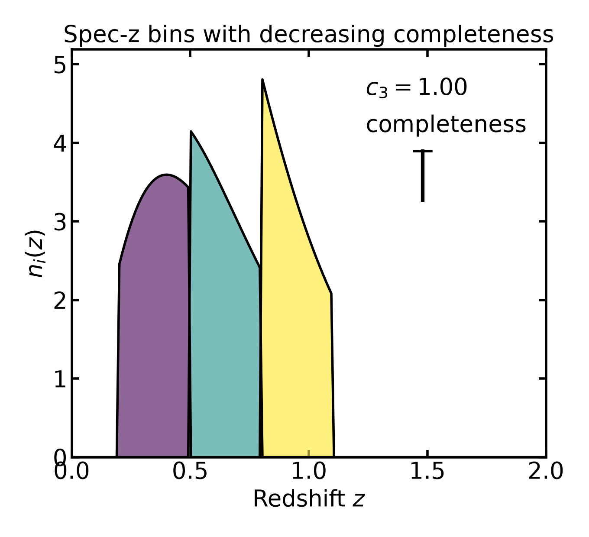
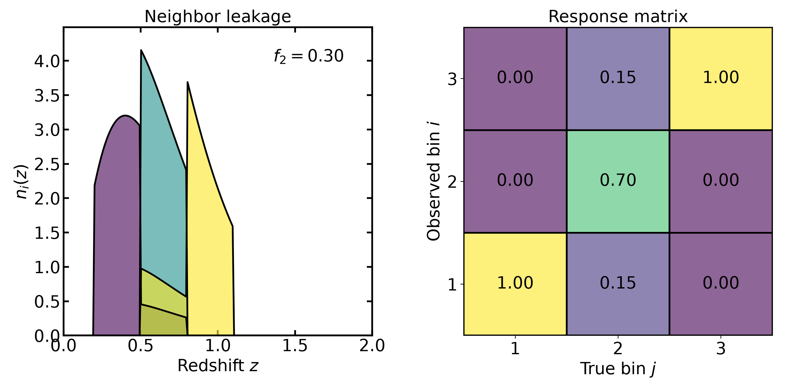
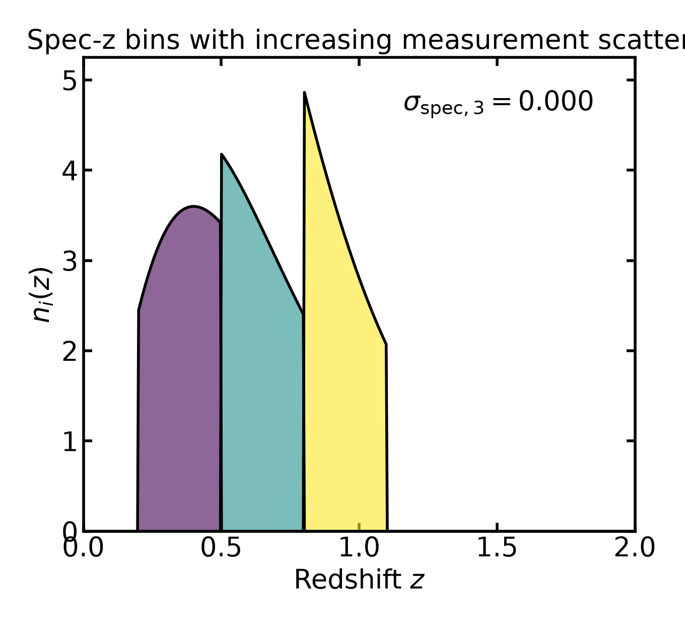

.. |logo| image:: ../../../_static/assets/logo.png
   :alt: logo
   :width: 32px

|logo| Spectroscopic-redshift uncertainties
===========================================

In spectroscopic-redshift tomography, nominal bins are defined in true
redshift. In the ideal case this corresponds to perfectly sharp bin edges.
Real surveys, however, may introduce incompleteness, misclassification, or
measurement scatter, which can be modeled through additional response terms.

For true-redshift bin edges :math:`e_j` and :math:`e_{j+1}`, the true-bin
selection function is

.. math::

   S_j^{\mathrm{true}}(z)
   =
   c_j\,\mathbf{1}_{[e_j,e_{j+1})}(z),

where

- :math:`j` is the true-bin index,
- :math:`c_j` is the completeness factor for bin :math:`j`,
- :math:`\mathbf{1}_{[e_j,e_{j+1})}(z)` is the indicator function, equal to
  :math:`1` when :math:`z \in [e_j,e_{j+1})` and :math:`0` otherwise,
- :math:`e_j` and :math:`e_{j+1}` are the lower and upper edges of true bin
  :math:`j`.

The corresponding raw true-bin distribution is

.. math::

   n_j^{\mathrm{true,raw}}(z)
   =
   n(z)\,S_j^{\mathrm{true}}(z),

where :math:`n(z)` is the parent redshift distribution.

In the absence of response effects, the observed and true bins coincide:

.. math::

   n_i^{\mathrm{raw}}(z)
   =
   n_i^{\mathrm{true,raw}}(z).

All resulting bin distributions are evaluated on the true-redshift grid,
following the general construction described in
:doc:`/theory/tomography/tomography`.

Completeness
------------

The simplest spec-z uncertainty ingredient is the completeness factor:

.. math::

   S_j^{\mathrm{true}}(z)
   =
   c_j\,\mathbf{1}_{[e_j,e_{j+1})}(z),
   \qquad 0 \le c_j \le 1,

where

- :math:`c_j=1` corresponds to full completeness in bin :math:`j`,
- :math:`c_j<1` reduces the pre-normalization population in that bin.

This parameter represents objects that should belong to the bin but are
missing from the sample, for example due to survey selection effects or
failed spectroscopic measurements.

Completeness is constant within each nominal true bin and acts
multiplicatively before response mixing and normalization.

In the absence of response mixing, a positive completeness factor preserves
the normalized bin shape while reducing its total population.
When response mixing is present, changing the completeness of one true bin
may also affect the shapes and populations of multiple observed bins.

Completeness does not directly move galaxies between bins.
It removes a fraction of galaxies before any subsequent redistribution.

The animation below illustrates this effect without response mixing:
as completeness decreases, the amplitude of the affected raw bin decreases
while the other bins remain unchanged.

API mapping:

- :math:`c_j`: ``completeness``

Observed-bin response
---------------------

Although nominal spec-z bins are defined in true redshift, Binny also supports
response effects that map true bins into observed bins.
This is useful for modeling bin reassignment, imperfect classification,
or leakage between bins.

The response matrix is defined as

.. math::

   M_{ij} = P(i_{\mathrm{obs}} \mid j_{\mathrm{true}}),

where

- :math:`M_{ij}` is the probability that a retained object in true bin
  :math:`j` appears in observed bin :math:`i`,
- :math:`i` is the receiving observed-bin index,
- :math:`j` is the source true-bin index.

The response matrix has shape
:math:`(N_{\mathrm{bins}},N_{\mathrm{bins}})` and must satisfy

.. math::

   M_{ij} \ge 0,
   \qquad
   \sum_i M_{ij} = 1

for every true bin :math:`j`.

This column-stochastic condition ensures that every retained galaxy is
assigned to some observed bin.

The effective observed-bin selection function is

.. math::

   S_i(z)
   =
   \sum_j M_{ij}\,S_j^{\mathrm{true}}(z),

and the corresponding raw observed-bin distribution is

.. math::

   n_i^{\mathrm{raw}}(z)
   =
   n(z)\,S_i(z)
   =
   \sum_j M_{ij}\,n_j^{\mathrm{true,raw}}(z).

The response matrix acts along the bin axis rather than the redshift axis.
Objects reassigned to another observed bin retain their true redshift.

Because the matrix is column-stochastic,

.. math::

   \sum_i n_i^{\mathrm{raw}}(z)
   =
   \sum_j n_j^{\mathrm{true,raw}}(z).

Response mixing therefore preserves the total retained population before
independent bin normalization.
It does not restore objects lost through incompleteness or restricted
true-redshift coverage.

Catastrophic reassignment
~~~~~~~~~~~~~~~~~~~~~~~~~

One supported response effect is catastrophic bin reassignment.
For each true bin :math:`j`, a fraction :math:`f_j^{\mathrm{cat}}` of the
retained population is removed from the diagonal and redistributed to other
bins.

The response can be written as

.. math::

   M_{ij}^{\mathrm{cat}}
   =
   (1-f_j^{\mathrm{cat}})\delta_{ij}
   +
   f_j^{\mathrm{cat}}q_{ij},

where

- :math:`f_j^{\mathrm{cat}} \in [0,1]` is the catastrophic reassignment
  fraction for true bin :math:`j`,
- :math:`\delta_{ij}` is the Kronecker delta,
- :math:`q_{ij}` is the redistribution probability from true bin
  :math:`j` to observed bin :math:`i`.

For more than one bin, the redistribution probabilities satisfy
:math:`q_{jj}=0` and :math:`\sum_i q_{ij}=1`.

Increasing :math:`f_j^{\mathrm{cat}}` moves a larger fraction of the retained
population from its true bin into other bins.
For a single tomographic bin, the response remains the identity.

API mapping:

- :math:`f_j^{\mathrm{cat}}`: ``catastrophic_frac``

Uniform leakage
^^^^^^^^^^^^^^^

With ``leakage_model="uniform"``, the catastrophic fraction is distributed
equally among all other bins:

.. math::

   q_{ij}
   =
   \begin{cases}
      \dfrac{1}{N_{\mathrm{bins}}-1}, & i\neq j, \\
      0, & i=j.
   \end{cases}

This represents redistribution without preference for nearby bins.

Neighbor leakage
^^^^^^^^^^^^^^^^

With ``leakage_model="neighbor"``, the catastrophic fraction is distributed
to adjacent bins only.
Interior bins leak equally to the left and right neighbors, while edge
bins leak to their single available neighbor.

This is a simple model for local misclassification and is the default
leakage prescription.

Gaussian leakage in bin index
^^^^^^^^^^^^^^^^^^^^^^^^^^^^^

With ``leakage_model="gaussian"``, the catastrophic fraction is redistributed
according to a Gaussian kernel in bin-index space, with width
:math:`\lambda_j`:

.. math::

   q_{ij}
   \propto
   \exp\!\left[
      -\frac{(i-j)^2}{2\lambda_j^2}
   \right],
   \qquad i \neq j,

where

- :math:`q_{ij}` is the normalized leakage probability from true bin
  :math:`j` into observed bin :math:`i`,
- :math:`\lambda_j>0` is the Gaussian leakage width in bin-index space.

The diagonal weight is excluded, and the remaining weights are normalized
to sum to unity.

This allows leakage to remain concentrated near the original bin while still
reaching more distant bins with suppressed weight.

Note that this width is defined in bin-index space, not in continuous
redshift space.
For unequal-width redshift bins, equal index separations do not necessarily
correspond to equal redshift separations.

API mapping:

- :math:`\lambda_j`: ``leakage_sigma``

The animation above shows the **neighbor-leakage case**.
As the catastrophic fraction increases, a larger fraction of galaxies
from the affected true bin is reassigned to its neighboring bins.
The left panel shows the resulting observed-bin distributions, while
the matrix on the right shows the corresponding response matrix.

Explicit response matrices
~~~~~~~~~~~~~~~~~~~~~~~~~~

Instead of constructing the catastrophic response from the built-in leakage
models, the user may provide an explicit response matrix directly.

API mapping:

- :math:`M^{\mathrm{cat}}`: ``response_matrix``

When supplied, this matrix overrides ``catastrophic_frac``,
``leakage_model``, and ``leakage_sigma``.
It is validated to ensure that it has the correct shape and is
column-stochastic.

This is useful when the response is known from an external calibration,
a mock catalog, or a survey pipeline rather than a simple parametric model.

An explicit response matrix replaces only the catastrophic response.
If Gaussian measurement scatter is enabled, its response is subsequently
applied to the supplied matrix.

Spectroscopic measurement scatter
---------------------------------

Binny also supports an additional Gaussian measurement-scatter response.
Unlike catastrophic reassignment, this starts from a continuous
measurement uncertainty in redshift, which is subsequently approximated
by a bin-to-bin response matrix.

The Gaussian spectroscopic measurement model is

.. math::

   z_{\mathrm{sp}}\mid z
   \sim
   \mathcal{N}\!\left(z,\sigma_{\mathrm{spec}}^2(z)\right),

where

- :math:`z_{\mathrm{sp}}` is the measured spectroscopic redshift,
- :math:`z` is the true redshift,
- :math:`\sigma_{\mathrm{spec}}(z)` is the spectroscopic measurement
  standard deviation.

For positive scatter, the probability of landing in observed bin
:math:`i` at fixed true redshift is

.. math::

   P(i_{\mathrm{obs}}\mid z)
   =
   \int_{e_i}^{e_{i+1}}
   p(z_{\mathrm{sp}}\mid z)\,\mathrm{d}z_{\mathrm{sp}}.

The Gaussian interval probability is evaluated analytically:

.. math::

   P(i_{\mathrm{obs}}\mid z)
   =
   \frac{1}{2}
   \left[
      \operatorname{erf}\!\left(
         \frac{e_{i+1}-z}{\sqrt{2}\,\sigma_{\mathrm{spec}}(z)}
      \right)
      -
      \operatorname{erf}\!\left(
         \frac{e_i-z}{\sqrt{2}\,\sigma_{\mathrm{spec}}(z)}
      \right)
   \right].

The bin-level response is obtained by continuously averaging the
assignment probability over each true-redshift bin:

.. math::

   \widehat{M}_{ij}^{\mathrm{scatter}}
   =
   \frac{1}{e_{j+1}-e_j}
   \int_{e_j}^{e_{j+1}}
   P(i_{\mathrm{obs}}\mid z)\,\mathrm{d}z.

This average assumes uniform weighting in true redshift within each
source bin, rather than weighting by the parent redshift distribution.

Introducing the dimensionless coordinate

.. math::

   t = \frac{z-e_j}{e_{j+1}-e_j},

the response coefficient can equivalently be written as

.. math::

   \widehat{M}_{ij}^{\mathrm{scatter}}
   =
   \int_0^1
   P\!\left(
      i_{\mathrm{obs}}
      \mid e_j+t(e_{j+1}-e_j)
   \right)
   \,\mathrm{d}t.

The integral is evaluated using adaptive numerical quadrature, with
additional integration points near the true-bin boundaries to resolve
narrow Gaussian scatter.

The response coefficients depend on the bin edges and scatter
parameters, but not on the resolution or spacing of the sampled
true-redshift grid.

Each column is subsequently normalized to unity:

.. math::

   M_{ij}^{\mathrm{scatter}}
   =
   \frac{
      \widehat{M}_{ij}^{\mathrm{scatter}}
   }{
      \sum_k\widehat{M}_{kj}^{\mathrm{scatter}}
   }.

This ensures population conservation during response mixing.
The column normalization corresponds to conditioning the bin-averaged
assignment probabilities on remaining within the modeled observed-redshift
range.
Probability outside that range is therefore not treated as a loss of
objects.

In the exact zero-scatter limit, the corresponding response column
reduces to an identity column:

.. math::

   M_{ij}^{\mathrm{scatter}} = \delta_{ij},

where :math:`\delta_{ij}` is the Kronecker delta.

A true bin containing no sampled redshift grid points does not require
a special response-matrix fallback, because the integration is performed
over its continuous redshift interval.
Invalid scatter parameters or response columns that cannot be normalized
raise an error.

If catastrophic leakage is also present, the total response becomes

.. math::

   M^{\mathrm{total}}
   =
   M^{\mathrm{scatter}}M^{\mathrm{cat}},

where

- :math:`M^{\mathrm{total}}` is the total response matrix,
- :math:`M^{\mathrm{scatter}}` is the measurement-scatter response matrix,
- :math:`M^{\mathrm{cat}}` is the catastrophic-leakage response matrix.

The ordering applies catastrophic reassignment first, followed by
measurement-scatter redistribution.

.. note::

   Unlike the continuous assignment model described in
   :doc:`/theory/binning/uncertainties/photoz`, the spectroscopic scatter
   model uses bin-averaged response coefficients.
   The effective selection functions are therefore piecewise constant
   within the nominal true-bin intervals.

Scatter parameterizations
~~~~~~~~~~~~~~~~~~~~~~~~~

Two alternative ways of specifying the spectroscopic scatter are supported.

Explicit per-bin scatter
^^^^^^^^^^^^^^^^^^^^^^^^

The user may provide the scatter amplitude directly as a scalar or
per-bin sequence:

.. math::

   \sigma_{\mathrm{spec}}(z)
   =
   \sigma_{\mathrm{spec},j},
   \qquad z\in[e_j,e_{j+1}).

This sets a constant Gaussian scatter width associated with each true bin.

API mapping:

- :math:`\sigma_{\mathrm{spec},j}`: ``specz_scatter``

Parametric scatter model
^^^^^^^^^^^^^^^^^^^^^^^^

Alternatively, Binny implements the redshift-dependent model

.. math::

   \sigma_{\mathrm{spec}}(z)
   =
   \sigma_0+\sigma_1(1+z),

where

- :math:`\sigma_0` is the constant scatter floor,
- :math:`\sigma_1` is the coefficient of the redshift-dependent scatter.

Both parameters are non-negative scalars.

API mapping:

- :math:`\sigma_0`: ``sigma0``
- :math:`\sigma_1`: ``sigma1``

The corresponding ``specz_scatter_model`` is
``"sigma0_plus_sigma1_1pz"``.

Explicit ``specz_scatter`` cannot be combined with nonzero ``sigma0`` or
``sigma1`` values.

Implemented spec-z parameters
-----------------------------

The following spectroscopic parameters are implemented in Binny:

- ``completeness``: multiplicative true-bin completeness.
- ``catastrophic_frac``: fraction reassigned away from each true bin.
- ``leakage_model``: prescription for redistributing catastrophic leakage.
- ``leakage_sigma``: Gaussian leakage width in bin-index space.
- ``response_matrix``: explicit replacement for the catastrophic response.
- ``specz_scatter``: direct Gaussian measurement-scatter amplitude.
- ``specz_scatter_model``: parametric measurement-scatter prescription.
- ``sigma0``: constant scatter floor.
- ``sigma1``: redshift-dependent scatter coefficient.

The parameters ``completeness``, ``catastrophic_frac``, ``leakage_sigma``,
and ``specz_scatter`` may be supplied as scalars or per-bin sequences.

Completeness defaults to unity, while catastrophic reassignment and
measurement scatter are disabled by default.

No-uncertainty limit
--------------------

In the ideal spectroscopic limit,

- :math:`c_j=1` for all bins,
- :math:`f_j^{\mathrm{cat}}=0` for all bins,
- :math:`\sigma_{\mathrm{spec},j}=0` for all bins, or equivalently
  :math:`\sigma_0=\sigma_1=0`.

Provided that no nonidentity explicit response matrix is supplied,
the total response reduces to the identity and each tomographic bin
is simply a top-hat true-redshift slice of the parent distribution:

.. math::

   n_i^{\mathrm{raw}}(z)
   =
   n(z)\,\mathbf{1}_{[e_i,e_{i+1})}(z).

This is the idealized spectroscopic case with perfectly sharp binning
and no observed-bin mixing.

Normalization and interpretation
--------------------------------

As described in :doc:`/theory/tomography/tomography`, Binny distinguishes
between the parent distribution, raw bin distributions, and normalized
returned bins.

If ``normalize_input=True``, the parent distribution is normalized to
integrate to unity before bin construction.

The raw observed-bin integral is

.. math::

   A_i
   =
   \int n_i^{\mathrm{raw}}(z)\,\mathrm{d}z.

For a positive parent integral

.. math::

   A
   =
   \int n(z)\,\mathrm{d}z,

the fractional population in observed bin :math:`i` is

.. math::

   f_i = \frac{A_i}{A}.

Independent bin normalization is controlled by ``normalize=True`` in
the core tomography builder and ``normalize_bins=True`` in the lower-level
spectroscopic binning utility.

For nonempty bins, the normalized distribution is

.. math::

   n_i(z)
   =
   \frac{n_i^{\mathrm{raw}}(z)}{A_i}.

Normalization takes place after completeness and response mixing.

The normalized curves retain their redshift shapes, while their relative
population information is retained in the metadata.

For the core tomography builder, the relevant metadata entries are
``metadata["parent_nz"]["norm"]``,
``metadata["bins"]["bins_norms"]``, and
``metadata["bins"]["frac_per_bin"]``.

See also
--------

- :doc:`/theory/binning/uncertainties/photoz`
- :doc:`/theory/tomography/tomography`
- :doc:`/theory/analysis/statistics`
- :doc:`/examples/tomography/specz_bins`