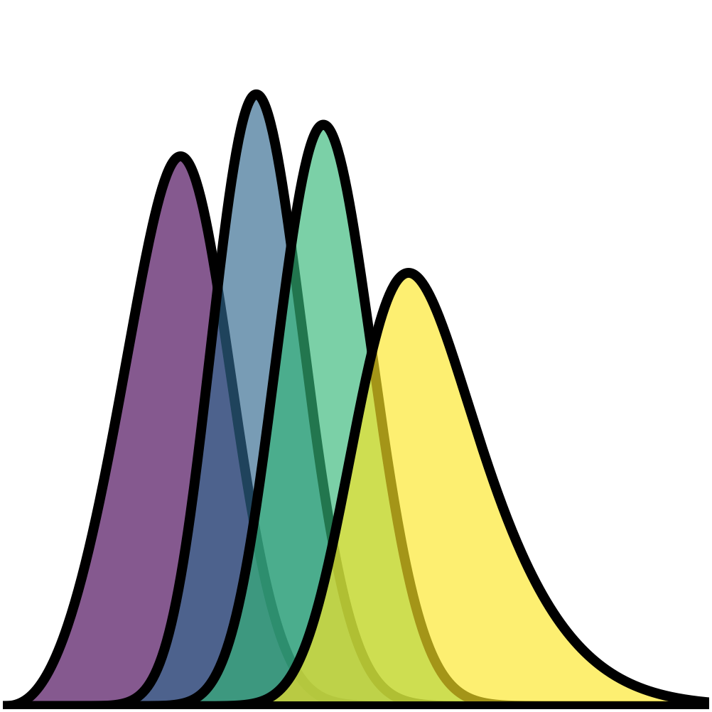

|logo| Conventions
==================

This page summarises the notation and conventions used throughout the
Binny documentation and API. The goal is to keep the mathematical
notation used in the documentation consistent with the variable names
used in the code.

Notation
--------

Throughout the documentation we use the following mathematical symbols.

Coordinates
^^^^^^^^^^^

A general numerical coordinate is denoted by :math:`x`.

A coordinate grid is written as

.. math::

   x = \{x_0, x_1, \ldots, x_{N-1}\}

where :math:`N` is the number of grid points.

The coordinate may represent, for example,

- redshift
- comoving distance
- magnitude
- luminosity
- mass
- another numerical quantity.

The generic binning algorithms in Binny operate on numerical
coordinates and are not restricted to redshift.

The interpretation and units of the coordinate depend on the
application.

Redshift
^^^^^^^^

- Redshift is denoted by :math:`z`.

- A redshift grid used for evaluating distributions is written as

  .. math::

     z = \{z_0, z_1, \ldots, z_{N-1}\}

- Tomographic redshift distributions in Binny are evaluated on a
  **true redshift grid** :math:`z`.

The coordinate used to construct bin boundaries does not necessarily
have to be the same as the coordinate used to evaluate the resulting
redshift distributions.

Redshift terminology
^^^^^^^^^^^^^^^^^^^^

Two types of redshift estimates commonly appear in tomographic
analyses.

**Spectroscopic redshift (spec-z)**

- Measured from spectroscopic observations
- Typically very precise
- Often treated as the **true redshift** :math:`z` in analyses
- May nevertheless be affected by measurement scatter,
  incompleteness, and catastrophic redshift errors

It is commonly abbreviated

- ``specz`` in code
- **spec-z** in text

**Photometric redshift (photo-z)**

- Estimated from broadband photometry
- Subject to measurement uncertainty and scatter
- Often used for defining tomographic bins

Common abbreviations include

- ``photoz`` in code
- ``photo-z`` in text
- ``pz`` in some cosmology literature

True vs observed redshift
^^^^^^^^^^^^^^^^^^^^^^^^^

Tomographic binning often distinguishes between

- **true redshift** :math:`z`
- **observed redshift** :math:`z_{\mathrm{obs}}`

The observed redshift may be obtained from photometric or
spectroscopic measurements.

Redshift uncertainties can be described by a conditional probability
density

.. math::

   p(z_{\mathrm{obs}} \mid z)

which describes the distribution of observed redshifts
:math:`z_{\mathrm{obs}}` for galaxies with true redshift :math:`z`.

In photometric tomography this conditional probability density
describes the photo-z error model.

In spectroscopic tomography the distinction between true and observed
redshift allows measurement uncertainties to be included rather than
assuming that spectroscopic redshifts are exact.

In Binny, constructed tomographic redshift distributions are returned
as functions of the **true redshift grid** :math:`z`, even when bins
are defined using observed redshift selections.

Redshift distributions
^^^^^^^^^^^^^^^^^^^^^^

The redshift distribution of a parent galaxy sample is

.. math::

   n(z)

Tomographic bin distributions before independent normalization are
written as

.. math::

   n_i^{\mathrm{raw}}(z)

These represent the selected contributions of bin :math:`i` from the
parent distribution :math:`n(z)`, where :math:`i` denotes the bin
index.

The corresponding independently normalized bin distribution is

.. math::

   n_i(z)

with

.. math::

   \int n_i(z)\,\mathrm{d}z = 1

when the raw bin distribution has a positive finite integral.

When the distinction between raw and normalized distributions is not
important, :math:`n_i(z)` may be used generically to denote the
distribution of bin :math:`i`.

The normalization convention should be stated explicitly whenever
population fractions or absolute galaxy abundances are considered.

Bin edges
^^^^^^^^^

Bins along a general numerical coordinate :math:`x` are defined by
a sequence of boundaries

.. math::

   \{e_0, e_1, \ldots, e_{N_{\mathrm{bins}}}\}

where :math:`N_{\mathrm{bins}}` is the number of bins.

For consecutive bins, the lower and upper boundaries of bin
:math:`i` are

.. math::

   x_i^{\mathrm{min}} = e_i,
   \qquad
   x_i^{\mathrm{max}} = e_{i+1}

For redshift binning these boundaries may instead be written as

.. math::

   z_i^{\mathrm{min}},
   \qquad
   z_i^{\mathrm{max}}

or, when the selection is defined in observed redshift,

.. math::

   z_{\mathrm{obs},i}^{\mathrm{min}},
   \qquad
   z_{\mathrm{obs},i}^{\mathrm{max}}

The bin edges describe the nominal intervals used for bin construction.
They do not necessarily describe the full support of the resulting
tomographic redshift distributions.

Selection windows
^^^^^^^^^^^^^^^^^

The effective bin selection function is denoted

.. math::

   S_i(z)

The raw tomographic redshift distribution is then written as

.. math::

   n_i^{\mathrm{raw}}(z) = n(z) S_i(z)

For example, in the case of ideal spectroscopic bins,

.. math::

   S_i(z) =
   \begin{cases}
   1 & z_i^{\mathrm{min}} \le z < z_i^{\mathrm{max}} \\
   0 & \text{otherwise}
   \end{cases}

In photometric tomography this window becomes a probabilistic
assignment function,

.. math::

   S_i(z) =
   \int_{z_{\mathrm{obs},i}^{\mathrm{min}}}
        ^{z_{\mathrm{obs},i}^{\mathrm{max}}}
   p(z_{\mathrm{obs}} \mid z)\,
   \mathrm{d}z_{\mathrm{obs}}

For probabilistic assignments,

.. math::

   0 \le S_i(z) \le 1

More general weighted selections may be described by non-negative
selection functions that are not necessarily probabilities.

The notation :math:`S_i(z)` is used for galaxy selection functions to
distinguish them from cosmological projection kernels, which are
commonly denoted by :math:`W_i(z)`.

Bin indices
-----------

Tomographic bins are indexed by

.. math::

   i = 0, 1, \ldots, N_{\mathrm{bins}} - 1

This matches the zero-based indexing used in Python arrays and the
bin dictionaries constructed by Binny.

Throughout the documentation, when a matrix is considered,

- :math:`i` denotes a **row index**
- :math:`j` denotes a **column index**

For correlations between different galaxy samples, the two indices
may refer to bins belonging to different tomographic bin sets.

Correlation ordering
--------------------

When correlations between bins of the same sample are symmetric,
a commonly used convention is

.. math::

   i \le j

meaning that only the **upper triangle** of the correlation matrix
needs to be considered.

This is common in cosmology where correlations such as

.. math::

   C_\ell^{ij}

satisfy

.. math::

   C_\ell^{ij} = C_\ell^{ji}

and therefore only one triangular part of the matrix needs to be
evaluated or stored.

When matrices are visualised, however, the full symmetric matrix may
be shown for clarity.

Binny provides several bin-pair ordering and selection conventions,
including upper-triangular, lower-triangular, diagonal, off-diagonal,
and Cartesian combinations.

For correlations between different galaxy samples, such as lens and
source samples, the corresponding bin indices have distinct roles.

In this case, the symmetry of correlations does not generally imply
that

.. math::

   C_\ell^{g\gamma,\,ij}
   =
   C_\ell^{g\gamma,\,ji}

within the same ordered lens--source bin convention.

The appropriate bin combinations therefore depend on the observable
and the galaxy samples being considered.

Sample naming
-------------

In cosmology analyses the terms **lens** and **source** have specific
physical meaning. In Binny we distinguish between two levels of naming.

Generic bin sets
^^^^^^^^^^^^^^^^

For general tomography examples we refer simply to

- **bins**
- **bin sets**
- **tomographic bins**

without assuming a specific cosmological role.

Cosmology-specific naming
^^^^^^^^^^^^^^^^^^^^^^^^^

When used in a large-scale structure context the two most common galaxy
samples are

**Lens sample**

- foreground galaxies used for clustering or galaxy--galaxy lensing

**Source sample**

- galaxies whose shapes are used for weak-lensing measurements

In galaxy--galaxy lensing, source galaxies are ideally located behind
the corresponding lens population.

API argument names
------------------

Function arguments in Binny use **plain descriptive names** rather than
mathematical symbols.

For example:

.. list-table::
   :header-rows: 1
   :widths: 30 70

   * - Argument name
     - Mathematical meaning
   * - ``x``
     - General numerical coordinate :math:`x`
   * - ``z``
     - Redshift coordinate :math:`z`
   * - ``nz``
     - Parent redshift distribution :math:`n(z)`
   * - ``bin_edges``
     - Bin boundaries :math:`\{e_0, \ldots, e_{N_{\mathrm{bins}}}\}`
   * - ``bins``
     - Mapping from bin indices to bin distributions
   * - ``n_bins``
     - Number of bins :math:`N_{\mathrm{bins}}`

The documentation may use the mathematical notation for clarity,
while the API consistently uses readable argument names.

Data structures
---------------

Tomographic bins returned by Binny typically follow the structure

.. code-block:: python

   bins = {
       0: array([...]),
       1: array([...]),
       2: array([...]),
   }

where

- the dictionary key is the **bin index**
- the value is the **bin distribution evaluated on the redshift grid**

The bin distributions, parent distribution, redshift grid, bin edges,
and associated information can be represented together in a
:class:`binny.tomography.Tomography` object.

Matrices
--------

Diagnostics that compare bins (overlap matrices, leakage matrices,
correlation matrices) are written mathematically as

.. math::

   M_{ij}

where :math:`i` and :math:`j` identify the corresponding bins.

Depending on the diagnostic, these may correspond in Python to nested
dictionaries or arrays of the form

.. code-block:: python

   matrix[i][j]

Matrices comparing two different bin sets need not be square or
symmetric.

Normalization conventions
-------------------------

Binny distinguishes between parent distributions, raw tomographic
distributions, independently normalized tomographic distributions,
and population fractions.

Parent distribution
^^^^^^^^^^^^^^^^^^^

The integral of the parent redshift distribution is denoted by

.. math::

   A = \int n(z)\,\mathrm{d}z

For a normalized parent distribution,

.. math::

   A = 1

However, parent distributions do not necessarily have to be normalized.
Their normalization depends on the supplied distribution and the
conventions used in the analysis.

Raw tomographic distributions
^^^^^^^^^^^^^^^^^^^^^^^^^^^^^

The integral of the raw distribution of bin :math:`i` is

.. math::

   A_i =
   \int n_i^{\mathrm{raw}}(z)\,\mathrm{d}z

The raw distribution retains the relative contribution of the
selected population to the parent distribution.

Normalized tomographic distributions
^^^^^^^^^^^^^^^^^^^^^^^^^^^^^^^^^^^^

When independent bin normalization is requested, each bin distribution
with a positive finite integral is normalized according to

.. math::

   n_i(z) =
   \frac{n_i^{\mathrm{raw}}(z)}{A_i}

such that

.. math::

   \int n_i(z)\,\mathrm{d}z = 1

Independent normalization preserves the shape of each bin distribution
but removes its relative population normalization.

Consequently, if all :math:`N_{\mathrm{bins}}` bin distributions
are independently normalized,

.. math::

   \sum_i \int n_i(z)\,\mathrm{d}z
   = N_{\mathrm{bins}}

rather than unity.

Population fractions
^^^^^^^^^^^^^^^^^^^^

The relative population contribution of bin :math:`i` is

.. math::

   f_i = \frac{A_i}{A}

where the parent integral :math:`A` is positive.

For probabilistic or deterministic selections, this quantity represents
the fraction of the parent population assigned to bin :math:`i`.

For general weighted selections, it represents the corresponding
relative weighted contribution.

If the selections form a complete and mutually exclusive partition
of the parent population,

.. math::

   \sum_i S_i(z) = 1

and therefore

.. math::

   \sum_i A_i = A

or, equivalently,

.. math::

   \sum_i f_i = 1

This condition does not necessarily hold for incomplete, overlapping,
or generally weighted selections.

Population fractions must therefore be distinguished from the
integrals of independently normalized bin distributions.

Redshift grids
--------------

Within an individual tomography constructed on a shared redshift grid,
the parent and tomographic redshift distributions are evaluated on
that grid.

For example

.. code-block:: python

   z = np.linspace(0, 2, 500)

Using a shared grid within a tomography ensures that

- bins can be compared directly
- diagnostic matrices can be computed consistently
- plotting functions can operate on aligned arrays.

Different tomographic samples may be constructed on different
redshift grids.

When comparing distributions defined on different grids, the grids
may need to be aligned or the distributions interpolated onto a
common coordinate grid.

The generic binning coordinate grid, the bin boundaries, and the
grid used to evaluate tomographic redshift distributions are distinct
concepts and should not be used interchangeably.

Cosmology analysis jargon
-------------------------

Large-scale structure and weak-lensing analyses often use shorthand
terminology for common combinations of observables.

**Weak lensing (WL)**

- weak gravitational distortion of background galaxy shapes
- often used interchangeably with **cosmic shear** in tomographic
  analyses, although weak lensing describes a broader class of
  phenomena and observables

**Cosmic shear**

- weak-lensing correlations measured between **source galaxy bins**
- typically written as shear--shear correlations
- often referred to as shear

  .. math::

     C_\ell^{\gamma\gamma,\,ij}

or simply

.. math::

   C_\ell^{ij}

when the observable is clear from context.

**Galaxy--galaxy lensing (GGL)**

- cross-correlation between **lens galaxies** and **source galaxy shapes**
- measures how foreground galaxies trace the surrounding matter field

  .. math::

     C_\ell^{g\gamma,\,ij}

where

- :math:`i` labels a **lens bin**
- :math:`j` labels a **source bin**

**Galaxy clustering**

- angular correlations of galaxies within the lens sample

  .. math::

     C_\ell^{gg,\,ij}

These correlations probe the spatial clustering of galaxies and their
relation to the underlying matter distribution.

Combined two-point analyses
---------------------------

Modern cosmology analyses often combine multiple two-point observables.
Common shorthand names include:

**3x2pt**

Joint analysis of three types of two-point correlations:

- galaxy clustering
- galaxy--galaxy lensing
- cosmic shear

Symbolically this corresponds to

.. math::

   \{C_\ell^{gg},\ C_\ell^{g\gamma},\ C_\ell^{\gamma\gamma}\}

This is the standard observable set used in many modern survey analyses.

**2x2pt**

Joint analysis using two of the three observables above. Common examples
include:

- **cosmic shear + galaxy clustering**

  .. math::

     \{C_\ell^{gg},\ C_\ell^{\gamma\gamma}\}

- **galaxy clustering + galaxy--galaxy lensing**

  .. math::

     \{C_\ell^{gg},\ C_\ell^{g\gamma}\}

The exact combination is only a shorthand and should be defined clearly
in each context.

In many large-scale structure analyses, 2x2pt refers to the combination
of galaxy clustering and galaxy--galaxy lensing.

However, cosmic shear can also be included in a two-observable analysis.

Bin roles in these analyses
---------------------------

In this terminology:

- **lens bins** refer to bins used for **galaxy clustering** and
  **galaxy--galaxy lensing**
- **source bins** refer to bins used for **weak lensing / cosmic shear**
  and **galaxy--galaxy lensing**

Thus:

- clustering correlations use **lens--lens bin pairs**
- galaxy--galaxy lensing uses **lens--source bin pairs**
- cosmic shear uses **source--source bin pairs**