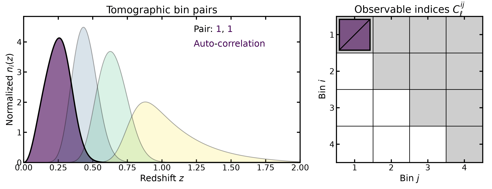

.. |logo| image:: ../../_static/assets/logo.png
   :alt: logo
   :width: 32px

|logo| Applications of tomography
=================================

Why tomography is useful
------------------------

Tomographic binning allows cosmological correlations to be studied
as a function of redshift, thereby probing the time evolution of
large-scale structure.

This is particularly important for observables that integrate
information along the line of sight, such as angular galaxy
clustering and weak gravitational lensing.

By splitting the galaxy sample into multiple bins, one gains access to

- **auto-bin correlations**, measured within the same tomographic bin;
- **cross-bin correlations**, measured between different tomographic bins.

Tomography produces both auto-bin and cross-bin observables,
corresponding to different pairs :math:`(i,j)` in the tomographic
data vector.

The joint analysis of auto- and cross-correlations enables sensitivity
to redshift-dependent physical effects such as the growth of structure,
geometric distances, and galaxy bias evolution.

These effects are partially degenerate in fully projected measurements
and can be better distinguished when redshift information is retained.

Tomographic weak-lensing analyses were formalized by Hu (1999)
[Hu1999]_, who showed that even coarse redshift binning can recover
a large fraction of the available three-dimensional information.

Selections based on other galaxy properties may also provide sensitivity
to population-dependent physical effects, such as luminosity-dependent
galaxy bias or intrinsic alignments.

The scientific motivation for a tomographic selection therefore
depends on the physical information that the analysis aims to retain
or distinguish.

Tomographic observables in different probes
^^^^^^^^^^^^^^^^^^^^^^^^^^^^^^^^^^^^^^^^^^^

In practice, correlations often involve **two distinct galaxy samples**
rather than a single one.

A common example is **galaxy--galaxy lensing**, where an analysis
uses a **lens sample** and a **source sample**, each with its own
set of tomographic bins.

In this case, the primary observable is the **cross-correlation
between lens positions and source galaxy shapes**, which probes the
matter distribution around foreground lens galaxies through its
gravitational lensing effect on background source galaxies.

Depending on the analysis strategy, additional correlations may also
be included, such as correlations within the lens sample
(galaxy clustering) or correlations within the source sample
(cosmic shear).

Different cosmological probes therefore make use of **different
subsets of the possible bin-pair correlations**.

For example:

- **Cosmic shear** uses correlations between source bins.
  Because shear--shear angular power spectra are symmetric in the
  bin indices, the pair :math:`(i,j)` is equivalent to
  :math:`(j,i)`.

- **Galaxy clustering** uses correlations between lens bins.
  These angular power spectra are also symmetric in
  the bin indices :math:`(i,j)`.

- **Galaxy--galaxy lensing** uses cross-correlations between lens
  and source bins.
  The two indices refer to different galaxy samples and therefore
  cannot generally be interchanged while keeping the field
  ordering fixed.

For two fields :math:`X` and :math:`Y`, the corresponding angular
cross-power spectra satisfy

.. math::

   C_\ell^{XY,\,ij} =
   C_\ell^{YX,\,ji}.

For fields belonging to the same sample and observable type,
this reduces to the familiar symmetry

.. math::

   C_\ell^{XX,\,ij} =
   C_\ell^{XX,\,ji}.

For galaxy--galaxy lensing, the corresponding relation is

.. math::

   C_\ell^{g\gamma,\,ij} =
   C_\ell^{\gamma g,\,ji}.

However, this does not generally imply

.. math::

   C_\ell^{g\gamma,\,ij} =
   C_\ell^{g\gamma,\,ji},

because the latter exchanges the bin indices without exchanging
the corresponding fields.

In combined analyses such as **3x2pt** (*the joint analysis of
cosmic shear, galaxy--galaxy lensing, and galaxy clustering
two-point correlations*), several probes are used simultaneously.

The resulting data vector may therefore contain a mix of auto-
and cross-correlations between the tomographic bins of different
galaxy samples.

Tomographic bin combinations
^^^^^^^^^^^^^^^^^^^^^^^^^^^^

For a single sample with :math:`N_{\mathrm{bins}}` tomographic bins,
the number of possible ordered bin pairs is

.. math::

   N_{\mathrm{pairs}} = N_{\mathrm{bins}}^2.

For a symmetric observable, only the unique pairs with

.. math::

   i \le j

need to be retained.

The corresponding number of unique bin pairs, including auto-bin
correlations, is

.. math::

   N_{\mathrm{pairs}} =
   \frac{
      N_{\mathrm{bins}}(N_{\mathrm{bins}}+1)
   }{2}.

For two distinct galaxy samples with :math:`N_{\mathrm{lens}}`
lens bins and :math:`N_{\mathrm{source}}` source bins, the number
of possible lens--source combinations is

.. math::

   N_{\mathrm{pairs}} =
   N_{\mathrm{lens}}N_{\mathrm{source}}.

Not all possible combinations necessarily need to be included
in a scientific analysis.

For example, galaxy--galaxy lensing analyses may select bin pairs
according to the relative locations or overlap of the lens and
source redshift distributions.

Other analyses may restrict the allowed combinations according to
additional scientific or statistical criteria.

Binny provides utilities for generating and filtering bin
combinations.

The available combinations and selection criteria are described
in :doc:`/theory/analysis/bin_combos`.

Role of binning in cosmological analyses
^^^^^^^^^^^^^^^^^^^^^^^^^^^^^^^^^^^^^^^^

Tomographic bins define the populations entering the observables
used in a cosmological analysis.

For example, a tomographic galaxy clustering measurement produces
angular power spectra

.. math::

   C_\ell^{gg,\,ij}

for the selected combinations of lens bins :math:`i` and :math:`j`.

Similarly, weak-lensing tomography produces angular shear power
spectra between source bins,

.. math::

   C_\ell^{\gamma\gamma,\,ij},

while galaxy--galaxy lensing produces angular cross-power spectra
between lens and source bins,

.. math::

   C_\ell^{g\gamma,\,ij}.

Joint analyses may combine these observables across multiple
tomographic bin pairs.

The number of bins, the choice of binning prescription, and the
selection of bin combinations therefore determine both the
dimensionality of the data vector and the redshift resolution
of the analysis.

For projected observables, tomographic angular power spectra
can be expressed as projections of three-dimensional power
spectra along the line of sight.

For illustration, under the Limber approximation in a
spatially flat cosmology, their signal contributions can
be written as

.. math::

   C_\ell^{XY,\,ij}
   \simeq
   \int_0^{\chi_{\mathrm{H}}}
   \frac{\mathrm{d}\chi}{\chi^2}
   W_i^X(\chi)\,W_j^Y(\chi)\,
   P_{XY}\!\left(
      k=\frac{\ell+1/2}{\chi},z(\chi)
   \right).

Here

- :math:`X` and :math:`Y` label the projected fields,
- :math:`P_{XY}(k,z)` is the relevant three-dimensional power
  spectrum, with its definition depending on the convention
  adopted for the projection kernels,
- :math:`\chi` is the comoving radial distance,
- :math:`\chi_{\mathrm{H}}` is the comoving horizon distance,
- :math:`W_i^X(\chi)` and :math:`W_j^Y(\chi)` are the projection
  kernels for the corresponding fields and tomographic bins.

Using the distance-redshift relation

.. math::

   \frac{\mathrm{d}\chi}{\mathrm{d}z}
   =
   \frac{c}{H(z)},

the projection can equivalently be expressed as an integral
over redshift,

.. math::

   C_\ell^{XY,\,ij}
   \simeq
   \int
   \frac{c\,\mathrm{d}z}{H(z)\chi^2(z)}
   W_i^X(\chi(z))\,W_j^Y(\chi(z))\,
   P_{XY}\!\left(
      k=\frac{\ell+1/2}{\chi(z)},z
   \right).

The projection kernels depend on the tomographic redshift
distributions :math:`n_i(z)`.

Different binning prescriptions and selection models therefore
modify the projection kernels and ultimately change the
observable correlations.

The form of the projection kernel depends on the observable
being considered.

Galaxy clustering kernel
""""""""""""""""""""""""

For the density contribution to galaxy clustering with
deterministic linear galaxy bias, the projection kernel
can be written as

.. math::

   W_i^g(\chi) =
   b_i(z(\chi))\,n_i(z(\chi))
   \frac{\mathrm{d}z}{\mathrm{d}\chi},

where :math:`b_i(z)` is the galaxy bias and the redshift
distribution :math:`n_i(z)` is normalized independently.

Equivalently,

.. math::

   W_i^g(\chi(z)) =
   \frac{H(z)}{c}\,b_i(z)\,n_i(z).

With this convention, the clustering angular power spectrum
is obtained by projecting the three-dimensional matter
power spectrum :math:`P_{\mathrm{mm}}(k,z)`.

This expression describes the galaxy density contribution.
Additional physical effects, such as magnification and
redshift-space distortions, may require further terms.

Weak-lensing kernel
"""""""""""""""""""

For gravitational lensing in a spatially flat cosmology,
the lensing efficiency kernel of source bin :math:`i`
can be written as

.. math::

   W_i^\gamma(\chi) =
   \frac{3H_0^2\Omega_{\mathrm{m}}}{2c^2}
   \frac{\chi}{a(\chi)}
   \int_\chi^{\chi_{\mathrm{H}}}
   \mathrm{d}\chi'\,
   n_i^\chi(\chi')
   \frac{\chi'-\chi}{\chi'},

where

- :math:`H_0` is the present-day Hubble parameter,
- :math:`\Omega_{\mathrm{m}}` is the matter density parameter,
- :math:`a(\chi)` is the scale factor,
- :math:`n_i^\chi(\chi)` is the normalized source distribution
  per unit comoving radial distance.

The comoving-distance distribution is related to the normalized
redshift distribution through

.. math::

   n_i^\chi(\chi) =
   n_i(z(\chi))
   \frac{\mathrm{d}z}{\mathrm{d}\chi}.

Unlike the galaxy density kernel, the lensing efficiency
kernel depends on an integral over the source population
behind the considered distance.

Cosmic shear and galaxy--galaxy lensing can therefore depend
on the tomographic redshift distributions in different ways.

The above expressions illustrate how tomographic distributions
enter cosmological projection calculations.

They are not intended as a complete description of all
contributions to the corresponding observables.

Binny constructs and characterizes the underlying tomographic
populations rather than computing the cosmological angular
power spectra themselves.

Choice of tomographic configuration
^^^^^^^^^^^^^^^^^^^^^^^^^^^^^^^^^^^

Increasing the number of tomographic bins can provide finer
resolution of redshift-dependent physical effects.

However, subdividing a fixed galaxy population also reduces
the number of galaxies available in individual bins.

This can increase the statistical noise associated with
individual tomographic measurements.

In addition, redshift uncertainties may limit the effective
resolution that can be achieved by introducing narrower bins.

Highly overlapping tomographic distributions may produce
strongly correlated observables and limited additional
independent information.

The choice of tomographic configuration therefore involves
a balance between

- redshift resolution,
- population size within individual bins,
- redshift uncertainties and selection effects,
- correlations between tomographic observables,
- sensitivity to the physical quantities of interest,
- computational cost.

There is no universally optimal binning prescription.

The preferred configuration depends on the galaxy sample,
the observable, the uncertainty model, and the scientific
objectives of the analysis.

References
----------

.. [Hu1999] Hu, W. (1999),
   *Power Spectrum Tomography with Weak Lensing*,
   ApJL 522, L21–L24.
   https://arxiv.org/abs/astro-ph/9904153
