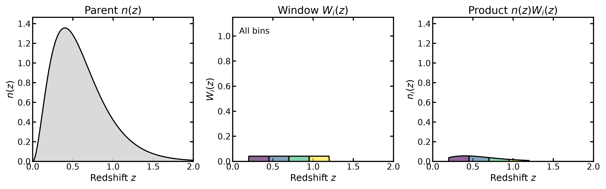
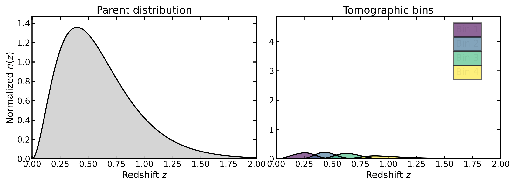
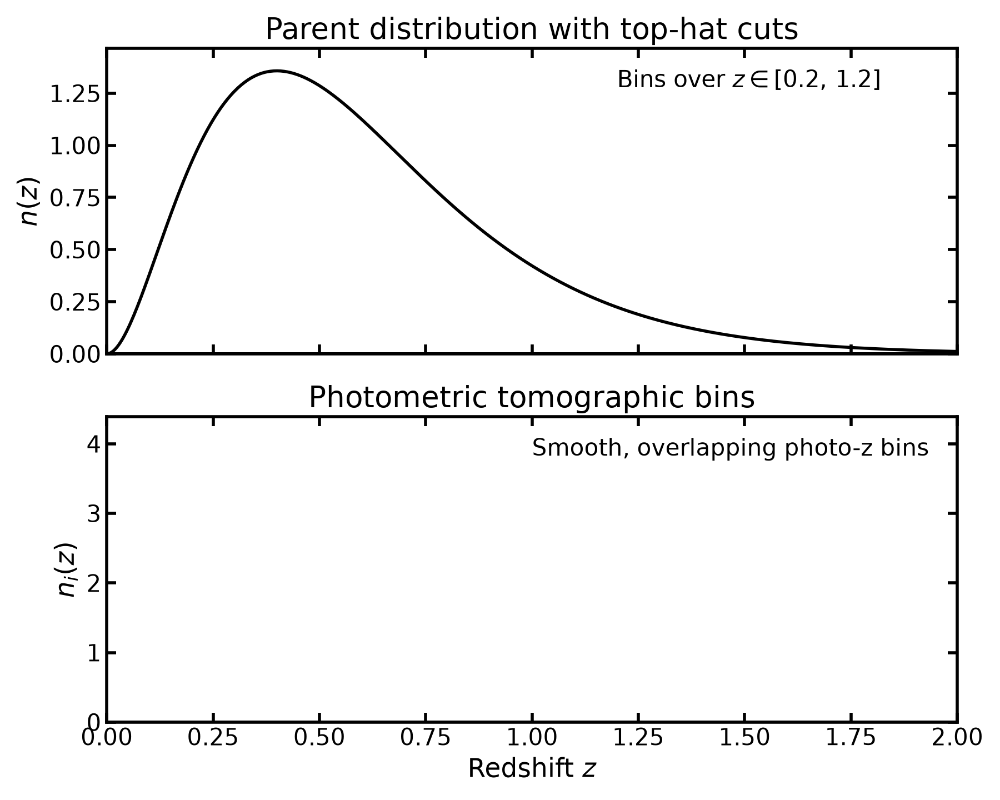
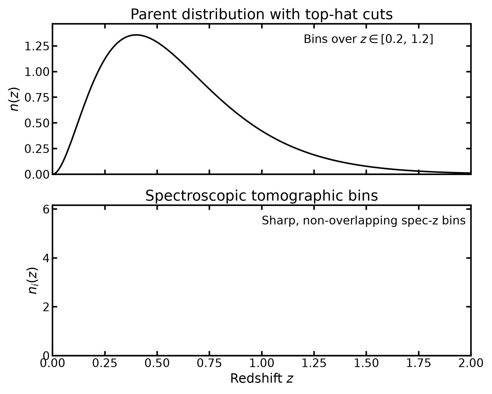
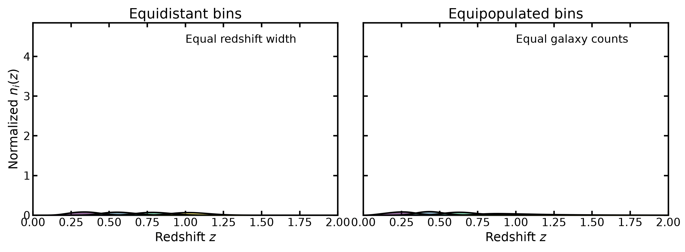

.. |logo| image:: ../../_static/assets/logo.png
   :alt: logo
   :width: 32px

|logo| Tomography
=================

Tomography in cosmological analyses refers to the practice of subdividing a
galaxy sample into populations and measuring correlations both within and
between these populations.

Most commonly, galaxies are subdivided into redshift bins.
By retaining partial redshift information, tomographic analyses recover
information that would otherwise be lost in fully projected
(two-dimensional) measurements.

More generally, galaxy samples may be subdivided according to other
quantities, such as luminosity, magnitude, mass, or combinations of
observational properties.

The resulting populations can each be described by their corresponding
redshift distributions.

Binny provides utilities for constructing tomographic populations
and inspecting their statistical properties.

Tomographic construction
------------------------

At the core of cosmological tomography is the redshift distribution of
galaxies, :math:`n(z)`, which describes the abundance of objects as a
function of redshift :math:`z`.

A tomographic construction defines a set of galaxy populations indexed by

.. math::

   i = 0, 1, \ldots, N_{\mathrm{bins}} - 1.

Following the notation introduced in :doc:`/theory/conventions`,
each bin is described through a selection function :math:`S_i(z)`,
such that the raw binned distribution becomes

.. math::

   n_i^{\mathrm{raw}}(z) = n(z)\,S_i(z).

Here

- :math:`z` denotes the true redshift,
- :math:`n(z)` is the **parent redshift distribution**, describing the
  distribution of galaxies as a function of redshift before selection,
- :math:`S_i(z)` is the **selection function** for bin :math:`i`,
  specifying how galaxies at redshift :math:`z` contribute to that bin,
- :math:`n_i^{\mathrm{raw}}(z)` is the resulting raw redshift distribution
  for bin :math:`i`,
- :math:`N_{\mathrm{bins}}` is the total number of tomographic bins
  in the analysis.

The selection functions determine which galaxies contribute to each bin
and how their contributions are weighted.

Deterministic selections
^^^^^^^^^^^^^^^^^^^^^^^^

In the simplest case, the selection function corresponds to a hard
redshift cut,

.. math::

   S_i(z) =
   \begin{cases}
     1 & e_i \le z < e_{i+1}, \\
     0 & \text{otherwise}.
   \end{cases}

where :math:`e_i` and :math:`e_{i+1}` denote the lower and upper redshift
boundaries of bin :math:`i`.

This corresponds to a deterministic assignment in which a galaxy
either belongs to the selected interval or does not.

More general selection functions are often used in practice, for
example when bins overlap or when galaxies contribute probabilistically
to multiple bins.

This illustrates the tomographic construction directly: a selection
function selects part of the parent distribution :math:`n(z)`,
yielding the raw binned distribution

.. math::

   n_i^{\mathrm{raw}}(z) = n(z)\,S_i(z).

Applying this construction for a set of selection functions

.. math::

   \{S_i(z)\}_{i=0}^{N_{\mathrm{bins}}-1}

produces the full collection of tomographic bin curves.

A parent redshift distribution can therefore be used to construct a set
of tomographic bin curves, each defined on the same redshift grid.

Probabilistic selections
^^^^^^^^^^^^^^^^^^^^^^^^

In many applications, the quantity used to assign galaxies to bins
is not known exactly.

Instead, the assignment is described by a probability distribution.

For example, galaxies may be assigned to bins using observed redshift
:math:`z_{\mathrm{obs}}`, while their underlying redshift distribution
is defined in true redshift :math:`z`.

The relation between true and observed redshift is described by the
conditional probability density

.. math::

   p(z_{\mathrm{obs}} \mid z).

The effective selection function for bin :math:`i` is then

.. math::

   S_i(z) =
   \int_{e_i}^{e_{i+1}}
   p(z_{\mathrm{obs}} \mid z)\,
   \mathrm{d}z_{\mathrm{obs}}.

The resulting selection function describes the probability that a galaxy
with true redshift :math:`z` is assigned to bin :math:`i`.

For probabilistic selections,

.. math::

   0 \le S_i(z) \le 1.

Unlike deterministic selections, probabilistic selections generally
allow galaxies at the same true redshift to contribute to multiple
tomographic bin distributions.

This does not necessarily imply that individual galaxies in an observed
catalog are assigned to multiple bins.

Rather, galaxies with the same true redshift may have different
observed redshifts and therefore different bin assignments.

Weighted selections
^^^^^^^^^^^^^^^^^^^

Selection functions may also represent more general non-negative
weights rather than assignment probabilities.

In this case,

.. math::

   S_i(z) \ge 0,

without requiring that the selection function be bounded above by unity.

The same construction applies,

.. math::

   n_i^{\mathrm{raw}}(z) = n(z)\,S_i(z),

but the resulting distribution represents a weighted population
rather than necessarily a count of selected galaxies.

The interpretation of its integral therefore depends on the
definition of the supplied weights.

Binny distinguishes between probabilistic and weighted selections
through the ``selection_kind`` argument of
:func:`binny.tomography.core.build_tomography`.

The supported selection kinds are ``probability`` and ``weight``.

Selection coordinates
^^^^^^^^^^^^^^^^^^^^^

The coordinate used to define the selection intervals does not
necessarily have to be redshift.

Consider a general numerical coordinate :math:`x`, as described in
:doc:`/theory/binning/binning_schemes`.

The coordinate may represent, for example,

- observed redshift,
- luminosity,
- magnitude,
- stellar mass,
- another physical or observational property.

If the conditional distribution of this quantity at a given true
redshift is known,

.. math::

   p(x \mid z),

then the effective selection function is

.. math::

   S_i(z) =
   \int_{e_i}^{e_{i+1}}
   p(x \mid z)\,\mathrm{d}x.

The resulting redshift distribution is

.. math::

   n_i^{\mathrm{raw}}(z) =
   n(z)
   \int_{e_i}^{e_{i+1}}
   p(x \mid z)\,\mathrm{d}x.

This construction illustrates how galaxy populations selected according
to properties other than redshift can still be represented by their
redshift distributions.

For example, luminosity-selected samples may have different redshift
distributions even when no explicit redshift intervals are imposed.

More general selections may depend on several galaxy properties
simultaneously.

The selection function then represents the effective contribution of
galaxies at a given true redshift after accounting for the relevant
selection criteria.

In Binny, such effective selections can be supplied through custom
assignment functions.

The underlying physical or observational model that determines the
selection must be supplied by the user.

The generic binning algorithms determine where boundaries are placed,
while the assignment model determines how the selected coordinate
relates to the underlying redshift distribution.

Normalization and bin overlap
------------------------------

Tomographic bin distributions may be represented either in their raw
form or as independently normalized distributions.

These two representations describe the same redshift dependence,
but retain different information about the population.

Raw bin distributions
^^^^^^^^^^^^^^^^^^^^^

The raw bin distribution is

.. math::

   n_i^{\mathrm{raw}}(z) = n(z)\,S_i(z).

Let the integral of the parent distribution be

.. math::

   A = \int n(z)\,\mathrm{d}z,

and the integral of the raw bin distribution be

.. math::

   A_i =
   \int n_i^{\mathrm{raw}}(z)\,\mathrm{d}z.

The raw bin distributions retain the relative normalization of the
selected populations.

If the parent distribution represents a physical number density
per unit redshift, the integral of each raw bin distribution retains
the corresponding population normalization.

Normalized bin distributions
^^^^^^^^^^^^^^^^^^^^^^^^^^^^^

In many analyses, each tomographic bin curve is normalized independently
so that

.. math::

   \int n_i(z)\,\mathrm{d}z = 1.

For a raw bin distribution with a positive finite integral, the
normalized distribution is

.. math::

   n_i(z) =
   \frac{n_i^{\mathrm{raw}}(z)}{A_i}.

For probabilistic selections, the bin curves therefore represent
conditional redshift distributions rather than fractions of the
parent population.

For more general weighted selections, they represent the corresponding
normalized weighted redshift distributions.

As a consequence, the amplitude of a normalized bin curve may exceed
that of the parent distribution :math:`n(z)`, since each bin is
normalized independently.

Independent bin normalization preserves the shape of each distribution
but removes information about its relative population normalization.

In the core tomography builder, independent bin normalization is
enabled by default through ``normalize_bins=True``.

Normalization of the parent distribution is controlled separately
through ``normalize_input``, which defaults to ``True``.

Population fractions
^^^^^^^^^^^^^^^^^^^^

For a parent distribution with positive integral, the relative
population contribution of bin :math:`i` is

.. math::

   f_i = \frac{A_i}{A}.

Equivalently,

.. math::

   f_i =
   \frac{
      \int n(z)\,S_i(z)\,\mathrm{d}z
   }{
      \int n(z)\,\mathrm{d}z
   }.

For deterministic or probabilistic galaxy assignments, this quantity
represents the fraction of the parent population assigned to the bin.

For general weighted selections, it represents the corresponding
relative weighted contribution.

If the selection functions describe a complete and mutually exclusive
partition of the parent population,

.. math::

   \sum_i S_i(z) = 1,

then

.. math::

   \sum_i n_i^{\mathrm{raw}}(z) = n(z),

and consequently

.. math::

   \sum_i f_i = 1.

If the binning interval covers only part of the parent population,
or if the selections include incompleteness, the summed population
fraction may be smaller than unity.

More general overlapping assignments or weighted selections may
produce summed contributions greater than unity.

Population conservation is therefore a property of the selection
model rather than a universal requirement of tomographic construction.

The population fractions must be distinguished from the integrals of
independently normalized bin distributions.

Bin overlap
^^^^^^^^^^^

In realistic photometric surveys, bin curves typically overlap in
true redshift because galaxies are assigned to bins using photometric
redshift estimates rather than precise spectroscopic measurements.

Two bin distributions can overlap in true redshift even when their
selection intervals in observed redshift are mutually exclusive.

For example, galaxies at a given true redshift may scatter into
different observed-redshift bins.

The overlap of the resulting redshift distributions does not
necessarily imply that the same galaxies have been counted more
than once.

Similarly, overlapping redshift distributions do not necessarily
violate population conservation.

For an exhaustive set of mutually exclusive observed-redshift bins,
the corresponding assignment probabilities still satisfy

.. math::

   \sum_i S_i(z) = 1.

The degree of overlap depends on the redshift uncertainty model,
the bin boundaries, and the underlying parent distribution.

Binny provides diagnostics for comparing the shapes, overlap,
population fractions, and other statistical properties of
tomographic distributions.

Spectroscopic vs photometric tomography
---------------------------------------

Tomographic analyses are used in both spectroscopic and photometric
surveys, though the practical implementation differs.

Photometric tomography
^^^^^^^^^^^^^^^^^^^^^^

In photometric surveys, redshifts are estimated from broadband
photometry rather than directly from spectroscopic measurements.

Photometric redshift estimates are subject to measurement uncertainties,
systematic offsets, and potentially catastrophic outliers.

The resulting bins are typically broader in true redshift and may
overlap even when their nominal observed-redshift intervals are
mutually exclusive.

The tomographic selection is obtained by integrating the photo-z
error model over the observed-redshift interval of each bin.

Different photo-z uncertainty models can therefore produce different
tomographic redshift distributions even when the nominal bin boundaries
and parent distribution remain unchanged.

See :doc:`/theory/binning/uncertainties/photoz` for a detailed
description of photometric redshift uncertainty modelling.

Spectroscopic tomography
^^^^^^^^^^^^^^^^^^^^^^^^

In spectroscopic surveys, redshifts are generally measured with
high precision.

Tomographic bins can therefore often be defined with minimal overlap
in true redshift, and the corresponding selection functions are
frequently approximated by sharply bounded windows.

However, spectroscopic samples may also be affected by measurement
uncertainties, incompleteness, and incorrect redshift assignments.

These effects can modify the resulting redshift distributions and
introduce leakage between tomographic bins.

Ideal deterministic redshift selections represent a limiting case
of spectroscopic tomography in which redshift measurement errors
are neglected.

See :doc:`/theory/binning/uncertainties/specz` for a detailed
description of spectroscopic redshift uncertainty modelling.

Predefined tomography
---------------------

Tomographic redshift distributions do not necessarily have to be
constructed from a parent distribution and an assignment model.

They may instead be supplied directly from an external source,
such as

- observational measurements,
- simulations or mock catalogs,
- survey data products,
- an external calibration procedure,
- another analysis pipeline.

In this case, the tomographic distributions

.. math::

   \{n_i(z)\}_{i=0}^{N_{\mathrm{bins}}-1}

are already defined.

The bin curves can be validated, optionally normalized, and represented
together on a shared redshift grid without applying another binning
prescription or assignment model.

The interpretation of predefined bin distributions depends on their
original construction and normalization.

In particular, independently normalized predefined distributions
do not generally contain sufficient information to reconstruct the
relative populations of the original galaxy samples.

Population fractions or absolute population normalizations may
therefore need to be supplied separately.

Practical examples are provided in
:doc:`/examples/tomography/predefined_bins`.

Binning schemes
---------------

When tomographic populations are constructed using coordinate
intervals, a rule is required for defining their boundaries.

A binning prescription determines where these boundaries are placed,
while the assignment model determines how galaxies contribute to
the resulting populations.

Several binning strategies are commonly used.

Equidistant binning divides a coordinate interval into bins of equal
width.

Equipopulated binning instead places boundaries such that each
interval contains approximately the same integrated population
according to the distribution used to construct the boundaries.

Equal-number binning may be useful when constructing populations
with comparable galaxy counts.

However, comparable galaxy counts do not necessarily imply
comparable statistical weight or cosmological constraining power.

More flexible prescriptions can be constructed by incorporating
population densities, additional weighting functions, or transformed
coordinates such as comoving radial distance.

Mixed binning schemes can also combine different prescriptions
across adjacent coordinate intervals.

Such hybrid approaches allow the binning scheme to adapt to features
of the underlying distribution while preserving control over the
placement of bin boundaries.

A detailed mathematical description of the available prescriptions
is provided in :doc:`/theory/binning/binning_schemes`.

Tomography in Binny
-------------------

Binny separates the construction of tomographic populations
into several components.

- The parent redshift distribution describes the underlying
  galaxy population.
- The binning prescription determines the nominal boundaries
  along the selected coordinate.
- The assignment model determines how galaxies contribute
  to the resulting bins.
- The normalization convention determines how the resulting
  distributions are represented.
- The analysis utilities characterize and compare the
  resulting populations.

Alternatively, predefined tomographic distributions can be
supplied directly without constructing them through a
binning prescription and an assignment model.

The resulting populations are represented by a
:class:`binny.tomography.Tomography` object containing the
redshift grid, parent distribution, bin distributions, and
associated information.

The main public functions for constructing tomographies are

- :func:`binny.tomography.core.build_tomography`
- :func:`binny.tomography.builders.build_tomography_from_spec`
- :func:`binny.tomography.predefined.build_predefined_tomography`
- :func:`binny.surveys.survey_presets.build_survey_tomography`

The resulting bins are represented as redshift distributions,
allowing them to be analyzed, visualized, and compared
consistently across different tomographic configurations.

Practical usage examples are provided throughout the documentation:

- Examples of **parent redshift models** and analytic :math:`n(z)`
  functions are shown in :doc:`/examples/nz/nz_modelling`.
- Methods for **calibrating redshift distributions from simulations
  or mock catalogs** are demonstrated in
  :doc:`/examples/calibration/nz_calibration`.
- Detailed examples of **binning prescriptions** are provided
  in :doc:`/examples/binning/binning_schemes`.
- Detailed examples of **photometric tomography**, including
  overlapping bins constructed using photometric redshift
  uncertainty models, are provided in
  :doc:`/examples/tomography/photoz_bins`.
- Examples of **spectroscopic tomography** are shown in
  :doc:`/examples/tomography/specz_bins`.
- Examples of **predefined tomography** are provided in
  :doc:`/examples/tomography/predefined_bins`.
- Additional diagnostics for inspecting bin shapes, overlaps,
  and statistical properties are illustrated in
  :doc:`/examples/analysis/bin_diagnostics` and
  :doc:`/examples/analysis/bin_summaries`.
- Examples of **bin combination generation and selection**
  are provided in :doc:`/examples/analysis/selections`.
- Survey-specific tomographic configurations used in forecasting
  studies can also be constructed using the utilities described
  in :doc:`/examples/surveys/survey_presets`.

For the scientific applications of tomography, see
:doc:`/theory/tomography/applications`.
